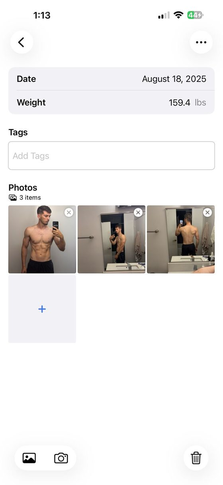
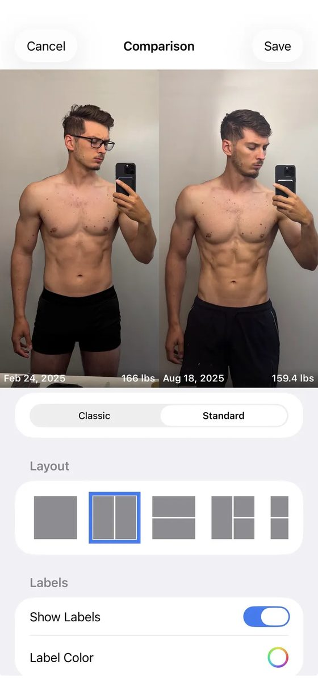
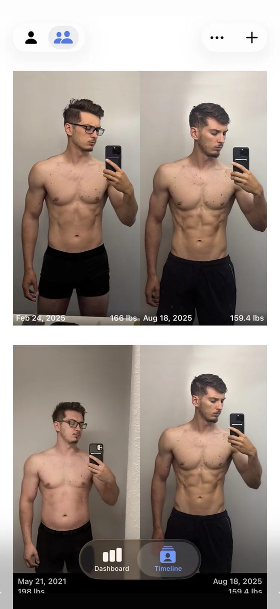
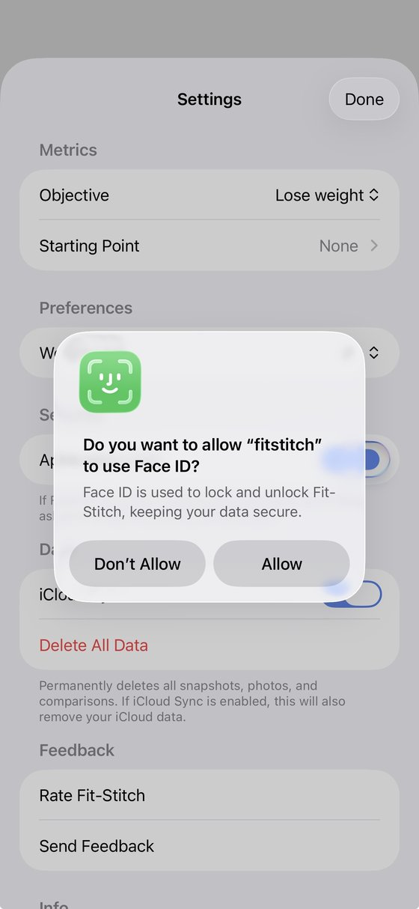
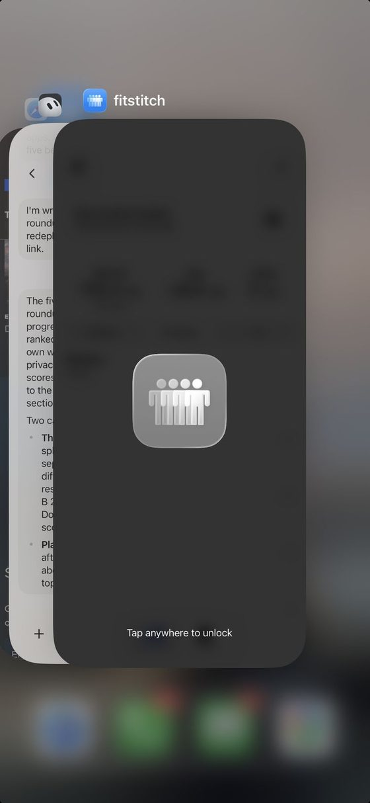

<!-- TODO(Mark): no "sameAs" on the author node yet. /about/ and the site link no X, Instagram, LinkedIn or GitHub profile for Mark. Add it here and on /about/ once one is public. -->

**Full disclosure: I build Recomp, a free progress photo app that competes with this one.** No app pays me <mark class="rounded-sm bg-yellow-200 px-1 text-black box-decoration-clone">\[CONFIRM: no ads, affiliate links or partner deals\]</mark>. This review expands the [Fit-Stitch entry](/blog/best-progress-photo-apps/#fit-stitch) in my [roundup of the best progress photo apps](/blog/best-progress-photo-apps/), scored with [the same kit](/blog/how-i-test-progress-photo-apps/). I rewrote it from my hands-on notes on Oct 2, 2026.

## What it costs {#what-it-costs}

**$4.99 upfront, with no in-app purchases and no account.** Every other paid app I graded sells a subscription. Fit-Stitch has been on the App Store since Jan 9, 2014.

## Taking a check-in {#taking-a-check-in}

**I scored capture 4 out of 5.** Date, weight, tags and several camera or library photos go on one form. There's no ghost overlay and no front, side and back slots. <mark class="rounded-sm bg-yellow-200 px-1 text-black box-decoration-clone">\[CONFIRM: no timer; the listing doesn't mention one\]</mark> <mark class="rounded-sm bg-yellow-200 px-1 text-black box-decoration-clone">\[TODO: seconds and taps to a saved check-in\]</mark>

**Tags arrived in 7.0 on Aug 11, 2026.** It's the only app of the 10 I checked with free-text tags. In my [study of 732 App Store reviews](/blog/what-people-want-from-progress-photo-apps/), nobody asked for them, though Fit-Stitch has had about one written review since they shipped.

{.phone}

## Lining photos up {#lining-photos-up}

**I scored alignment 0: there's no auto-alignment, no manual alignment and no ghost overlay.** Lining up a pair is on you, at capture. <mark class="rounded-sm bg-yellow-200 px-1 text-black box-decoration-clone">\[TODO: the rubric floor is 1; use 0 or 1?\]</mark>

## Comparing two dates {#comparing-two-dates}

**I scored comparison 1.** Each comparison is a card built in its own form, with no date scrubbing, so three old dates take three forms. The cards print the date and weight on each photo, which is useful once they exist.

**Its older reviewers liked a different layout.** Three reviews from 2014 to 2016 discuss its before/after layouts, and one asks it to "go back to the old before/after set up."

<figure class="m-0 min-w-0 flex-1"><figcaption class="mt-[0.65rem] text-center text-caption leading-[1.4] text-muted">Every comparison is built in its own form.</figcaption></figure><figure class="m-0 min-w-0 flex-1"><figcaption class="mt-[0.65rem] text-center text-caption leading-[1.4] text-muted">Saved comparison cards, with date and weight.</figcaption></figure>

## Importing old photos {#importing-old-photos}

**I scored import 0.** Nothing imports in bulk, and dates don't fill in from photo metadata, so a 450-photo archive means adding photos one at a time. Import is a bonus score, kept out of the total. <mark class="rounded-sm bg-yellow-200 px-1 text-black box-decoration-clone">\[TODO: performance with the full library\]</mark>

## Where your photos live {#where-your-photos-live}

**Photos stay on your device, with optional sync to a private iCloud container tied to your Apple ID.** The developer has no access to it, per its policy. The option first arrived as an "iCloud backup option" in 5.0 on Apr 10, 2017. Delete All Data also wipes the iCloud copy, so it's sync, not a separate backup. <mark class="rounded-sm bg-yellow-200 px-1 text-black box-decoration-clone">\[TODO: delete-and-restore test\]</mark>

**Face ID locks the app and blurs it in the app switcher.** I proposed 5 out of 5 for privacy, provisionally. Fit-Stitch alone accounts for 10 of the 26 lock or privacy mentions in my review study, mostly praise for its passcode.

<mark class="rounded-sm bg-yellow-200 px-1 text-black box-decoration-clone">\[TODO: label vs policy conflict. The label lists Health &amp; Fitness, User Content and Crash Data as Data Not Linked to You. The policy, updated Jul 27, 2026, says "Fit-Stitch does not include any third-party analytics, crash reporting, or advertising SDKs." Raise it; don't resolve it.\]</mark>

<figure class="m-0 min-w-0 flex-1"><figcaption class="mt-[0.65rem] text-center text-caption leading-[1.4] text-muted">Face ID prompt in Settings.</figcaption></figure><figure class="m-0 min-w-0 flex-1"><figcaption class="mt-[0.65rem] text-center text-caption leading-[1.4] text-muted">Face ID lock blurs the app switcher.</figcaption></figure>

## What reviewers say {#what-reviewers-say}

**A Sep 17, 2026 review says new photos disappeared.** Version 7.0.2 on Sep 30, 2026 says it "Fixed an issue where newly added photos could fail to save when iCloud storage was full." <mark class="rounded-sm bg-yellow-200 px-1 text-black box-decoration-clone">\[CONFIRM: the fix holds\]</mark> Reminders are the other theme: 12 of the 32 positive reminder reviews in my study are Fit-Stitch's.

## Scores so far {#scores-so-far}

<table class="w-max min-w-full border-collapse text-left text-micro">
<thead>
<tr>
<th class="whitespace-nowrap border-b border-card-border px-3 py-2 align-bottom font-semibold text-fg" scope="col">Score (1 to 5)</th>
<th class="whitespace-nowrap border-b border-card-border px-3 py-2 align-bottom font-semibold text-fg" scope="col">Fit-Stitch</th>
<th class="whitespace-nowrap border-b border-card-border px-3 py-2 align-bottom font-semibold text-fg" scope="col">Status</th>
</tr>
</thead>
<tbody>
<tr>
<th class="whitespace-nowrap border-b border-card-border px-3 py-2 align-top text-muted" scope="row">Capture and tracking</th>
<td class="border-b border-card-border px-3 py-2 align-top text-muted">4</td>
<td class="border-b border-card-border px-3 py-2 align-top text-muted">Scored</td>
</tr>
<tr>
<th class="whitespace-nowrap border-b border-card-border px-3 py-2 align-top text-muted" scope="row">Alignment</th>
<td class="border-b border-card-border px-3 py-2 align-top text-muted">0</td>
<td class="border-b border-card-border px-3 py-2 align-top text-muted">Scored; below the rubric floor of 1</td>
</tr>
<tr>
<th class="whitespace-nowrap border-b border-card-border px-3 py-2 align-top text-muted" scope="row">Comparison</th>
<td class="border-b border-card-border px-3 py-2 align-top text-muted">1</td>
<td class="border-b border-card-border px-3 py-2 align-top text-muted">Scored</td>
</tr>
<tr>
<th class="whitespace-nowrap border-b border-card-border px-3 py-2 align-top text-muted" scope="row">Design</th>
<td class="border-b border-card-border px-3 py-2 align-top text-muted">TBD</td>
<td class="border-b border-card-border px-3 py-2 align-top text-muted">"Simple and clean"</td>
</tr>
<tr>
<th class="whitespace-nowrap border-b border-card-border px-3 py-2 align-top text-muted" scope="row">Performance</th>
<td class="border-b border-card-border px-3 py-2 align-top text-muted">TBD</td>
<td class="border-b border-card-border px-3 py-2 align-top text-muted"></td>
</tr>
<tr>
<th class="whitespace-nowrap border-b border-card-border px-3 py-2 align-top text-muted" scope="row">Privacy</th>
<td class="border-b border-card-border px-3 py-2 align-top text-muted">5</td>
<td class="border-b border-card-border px-3 py-2 align-top text-muted">Provisional</td>
</tr>
<tr>
<th class="whitespace-nowrap border-b border-card-border px-3 py-2 align-top text-muted" scope="row">Backup</th>
<td class="border-b border-card-border px-3 py-2 align-top text-muted">TBD</td>
<td class="border-b border-card-border px-3 py-2 align-top text-muted">Restore test pending</td>
</tr>
<tr>
<th class="whitespace-nowrap border-b border-card-border px-3 py-2 align-top text-muted" scope="row">Import (bonus, outside the total)</th>
<td class="border-b border-card-border px-3 py-2 align-top text-muted">0</td>
<td class="border-b border-card-border px-3 py-2 align-top text-muted">Scored; below the rubric floor of 1</td>
</tr>
<tr>
<th class="whitespace-nowrap border-b border-card-border px-3 py-2 align-top text-muted" scope="row">Total out of 35</th>
<td class="border-b border-card-border px-3 py-2 align-top text-muted">TBD</td>
<td class="border-b border-card-border px-3 py-2 align-top text-muted">10 from the four scored</td>
</tr>
</tbody>
</table>

<mark class="rounded-sm bg-yellow-200 px-1 text-black box-decoration-clone">\[CONFIRM: rescore on the v8 rubric or the Oct 4 measured tiers. Power-user suite piece label.\]</mark>

## The numbers {#the-numbers}

**Every app's numbers sit side by side, with test dates, in [my test data](/blog/how-i-test-progress-photo-apps/#store-data).**

<table class="w-max min-w-full border-collapse text-left text-micro">
<thead>
<tr>
<th class="whitespace-nowrap border-b border-card-border px-3 py-2 align-bottom font-semibold text-fg" scope="col">Field</th>
<th class="whitespace-nowrap border-b border-card-border px-3 py-2 align-bottom font-semibold text-fg" scope="col">Value</th>
</tr>
</thead>
<tbody>
<tr>
<th class="whitespace-nowrap border-b border-card-border px-3 py-2 align-top text-muted" scope="row">Full name</th>
<td class="border-b border-card-border px-3 py-2 align-top text-muted">Fit-Stitch Progress Tracker</td>
</tr>
<tr>
<th class="whitespace-nowrap border-b border-card-border px-3 py-2 align-top text-muted" scope="row">Rating</th>
<td class="border-b border-card-border px-3 py-2 align-top text-muted">4.77 from 331 US ratings (Oct 3, 2026)</td>
</tr>
<tr>
<th class="whitespace-nowrap border-b border-card-border px-3 py-2 align-top text-muted" scope="row">Written reviews, Jul 2 to Oct 2, 2026</th>
<td class="border-b border-card-border px-3 py-2 align-top text-muted">1 (US feed)</td>
</tr>
<tr>
<th class="whitespace-nowrap border-b border-card-border px-3 py-2 align-top text-muted" scope="row">Written reviews in Apple's feed</th>
<td class="border-b border-card-border px-3 py-2 align-top text-muted">126 in my study</td>
</tr>
<tr>
<th class="whitespace-nowrap border-b border-card-border px-3 py-2 align-top text-muted" scope="row">First released</th>
<td class="border-b border-card-border px-3 py-2 align-top text-muted">Jan 9, 2014</td>
</tr>
<tr>
<th class="whitespace-nowrap border-b border-card-border px-3 py-2 align-top text-muted" scope="row">Last updated</th>
<td class="border-b border-card-border px-3 py-2 align-top text-muted">Sep 30, 2026</td>
</tr>
<tr>
<th class="whitespace-nowrap border-b border-card-border px-3 py-2 align-top text-muted" scope="row">Version tested</th>
<td class="border-b border-card-border px-3 py-2 align-top text-muted">7.0.2 <mark class="rounded-sm bg-yellow-200 px-1 text-black box-decoration-clone">[CONFIRM]</mark></td>
</tr>
<tr>
<th class="whitespace-nowrap border-b border-card-border px-3 py-2 align-top text-muted" scope="row">Requires</th>
<td class="border-b border-card-border px-3 py-2 align-top text-muted">iOS 17.0+ on iPhone and iPad; no Android ("Not at this time," per its FAQ)</td>
</tr>
<tr>
<th class="whitespace-nowrap border-b border-card-border px-3 py-2 align-top text-muted" scope="row">App Store</th>
<td class="border-b border-card-border px-3 py-2 align-top text-muted"><a href="https://apps.apple.com/us/app/fit-stitch-progress-tracker/id711835190">Fit-Stitch Progress Tracker on the App Store</a></td>
</tr>
</tbody>
</table>

## Who should use something else {#who-should-use-something-else}

**If you compare often, Fit-Stitch's one-form-per-comparison gets old fast.** For the most compare modes and auto-align, see my [Thumbstone review](/blog/thumbstone-review/). For date-reading import, see [Then &amp; Now](/blog/then-and-now-review/). For measurements and Apple Health, see [Lasmit](/blog/lasmit-review/).

## What I haven't tested yet {#what-i-havent-tested-yet}

**I still need design and performance scores, and a delete-and-restore with iCloud sync on.** That restore decides whether its sync really answers "what if I lose my phone?" If you've restored Fit-Stitch on a new phone, email me at [support@progressphotos.app](mailto:support@progressphotos.app).

<!-- chrome:author-bio depth="2" -->
<aside
class="mt-12 flex flex-wrap items-center gap-4 rounded-card border border-card-border bg-card px-[1.4rem] py-[1.35rem] sm:flex-nowrap sm:items-start"
aria-labelledby="author-bio-heading"
>
<!-- TODO(Mark): pick a photo. Replace this div with . The 64×64 box is reserved so nothing shifts. -->

<mark class="rounded-sm bg-yellow-200 px-1 text-black box-decoration-clone">TODO photo</mark>

<h2 id="author-bio-heading" class="min-w-0 flex-1 text-h4 font-bold tracking-h4">About the author</h2>

<strong class="text-fg">I'm Mark Stepchin, and I make Recomp, so read what I say about other apps with that in mind.</strong>
I'm a software engineer who has worked at Silicon Valley startups, with some time at Apple.
I've trained for years: I bulked from 145 to 195 lb, cut to 155, and now sit around 165.
Before building Recomp in my evenings and weekends from San Diego, I tried more than 10 progress photo apps.
<a href="../../about/">More about me</a>

<!-- TODO(Mark): the weight history comes from your Oct 17 brief and isn't on /about/ yet. Confirm the numbers before publishing. -->
<!-- TODO(Mark): "tried more than 10" is the public claim from /blog/why-i-built-recomp/. Don't say "tested 36 apps": 36 is the proposed candidate list in the how-i-test draft, with no screening log yet, and hands-on scoring is partial (6 of 10 apps have proposed scores). Once testing is done, this could read "I screened 36 apps and tested N hands-on." -->

</aside>
<!-- /chrome:author-bio -->
