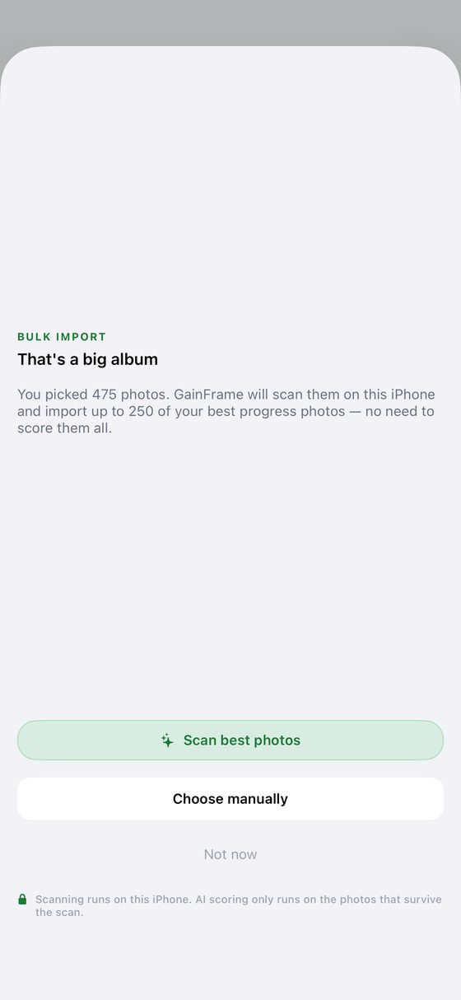
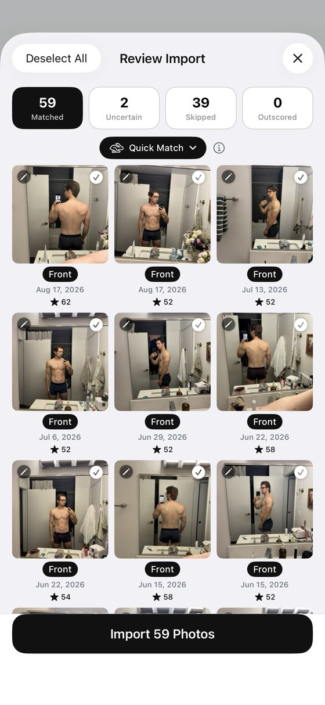
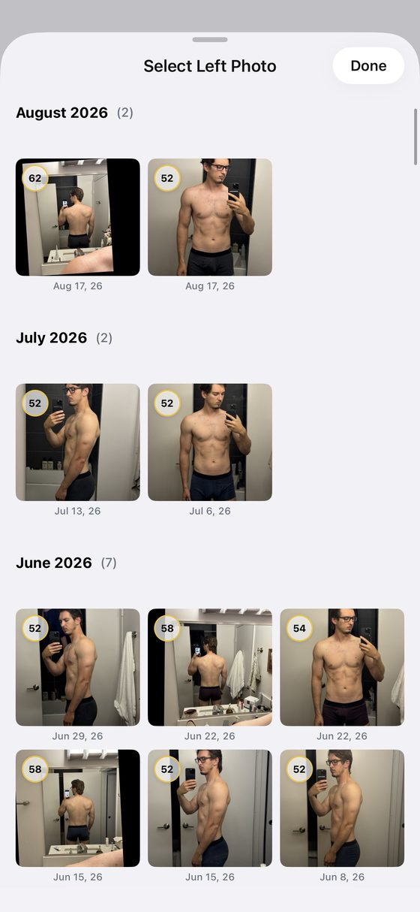
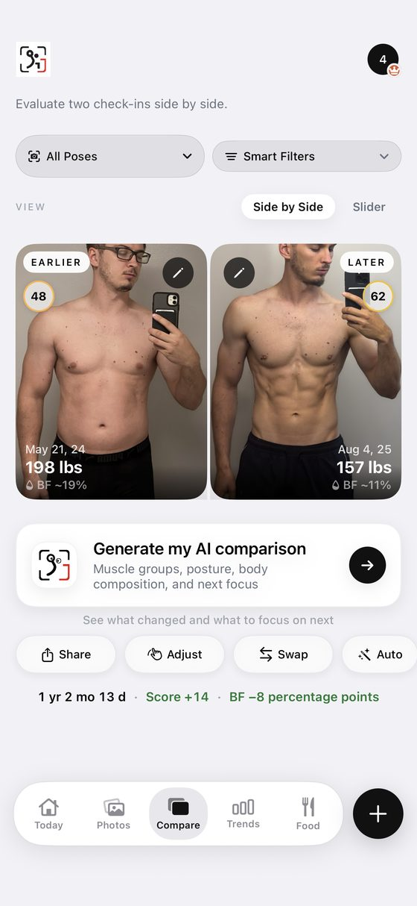
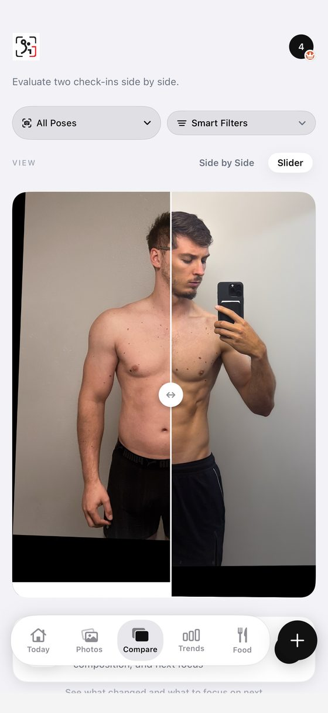

<!-- TODO(Mark): no "sameAs" on the author node yet. /about/ and the site link no X, Instagram, LinkedIn or GitHub profile for Mark. Add it here and on /about/ once one is public. -->

**Full disclosure: I build Recomp, a free progress photo app that competes with GainFrame.** Recomp has no in-app purchases, and no app pays me <mark class="rounded-sm bg-yellow-200 px-1 text-black box-decoration-clone">\[CONFIRM: no ads, affiliate links or partner deals\]</mark>. This review expands the [GainFrame entry](/blog/best-progress-photo-apps/#gainframe) in my [roundup of the best progress photo apps](/blog/best-progress-photo-apps/), and every app went through the [same test kit and scorecard](/blog/how-i-test-progress-photo-apps/).

<mark class="rounded-sm bg-yellow-200 px-1 text-black box-decoration-clone">\[TODO: Mark's Oct 4 notes say GainFrame has a full-screen view and maybe two other compare screens he hasn't fully checked. Re-check them before scoring alignment and comparison.\]</mark>

## What GainFrame costs {#what-gainframe-costs}

**GainFrame is free to download, with five paid plans.** It sells $3.99 a week, $5.99 or $9.99 a month, and $39.99 or $49.99 a year. <mark class="rounded-sm bg-yellow-200 px-1 text-black box-decoration-clone">\[TODO: which features the free tier keeps, and which plan Mark bought for the test\]</mark>

## Importing a big library {#importing-a-big-library}

**GainFrame took my 475-photo album in one pick but imports at most 250, the most recent ones.** The import took about 15 minutes. <mark class="rounded-sm bg-yellow-200 px-1 text-black box-decoration-clone">\[CONFIRM: whether all 250 imported; the review screen showed "Import 59 Photos"\]</mark> <mark class="rounded-sm bg-yellow-200 px-1 text-black box-decoration-clone">\[TODO: Mark recalls about 30 minutes to process 450 photos; the draft says about 15 minutes for the 475-photo album. Settle which run each number came from.\]</mark>

**The loading states during import are the best in the category.** I'm using them as the reference for Recomp's bulk import. An on-device scan picks your "best" photos and labels each pose, and it labeled one of my back shots "Front."

<figure class="m-0 min-w-0 flex-1"><figcaption class="mt-[0.65rem] text-center text-caption leading-[1.4] text-muted">475 photos picked, 250 imported at most.</figcaption></figure><figure class="m-0 min-w-0 flex-1"><figcaption class="mt-[0.65rem] text-center text-caption leading-[1.4] text-muted">A back shot labeled Front.</figcaption></figure>

## Picking two photos to compare {#picking-two-photos-to-compare}

**Choosing the before or after photo opens a picker with thumbnails about a third of the screen tall.** Finding one week among hundreds means long scrolling, month by month. With a real library I couldn't find a specific photo. Every app's picker is awkward to some degree, and GainFrame's is the one that hurt most at scale.

{.phone}

## Comparing two dates {#comparing-two-dates}

**The compare screen puts photo comparison second.** Photos sit in small boxes, and AI labels cover them. It offers a standard slider and side by side, with weight, a body-fat estimate and a score next to each photo. Auto and Adjust buttons sit in compare, and black borders on the slider suggest it auto-aligns the pair. <mark class="rounded-sm bg-yellow-200 px-1 text-black box-decoration-clone">\[CONFIRM: whether Auto aligns the pair, and how well\]</mark>

<figure class="m-0 min-w-0 flex-1"><figcaption class="mt-[0.65rem] text-center text-caption leading-[1.4] text-muted">Side by side with weight, BF estimate and score.</figcaption></figure><figure class="m-0 min-w-0 flex-1"><figcaption class="mt-[0.65rem] text-center text-caption leading-[1.4] text-muted">Slider compare, with black alignment borders.</figcaption></figure>

## Design and speed {#design-and-speed}

**Design is GainFrame's strength, and performance is its weakness.** I proposed a 4 out of 5 for design: high polish, with icons and layout that look great. I proposed a 2 for performance: past 250 photos, both import and compare bogged down. You can see the developer put a lot of effort in.

## AI body-fat estimates and scores {#ai-body-fat-estimates-and-scores}

**GainFrame estimates body fat with AI, which I don't grade.** Its listing also has FFMI and muscle scores, XP and trophies, streaks, an opt-in leaderboard, share cards and a widget. AI scores are noisy across the category: in Rate My Physique, one photo I posted twice scored 9.6, then 8.5. <mark class="rounded-sm bg-yellow-200 px-1 text-black box-decoration-clone">\[TODO: link the AI body-fat accuracy article (REC-80, PR #19) once it's live.\]</mark>

**Five written App Store reviews praise GainFrame's AI analysis, and two of them name body fat.** They come from my [study of 732 App Store reviews](/blog/what-people-want-from-progress-photo-apps/). A cluster of warm 5-star reviews landed Mar 21 to 23, 2026, two weeks after launch, and may come from its tester group. <mark class="rounded-sm bg-yellow-200 px-1 text-black box-decoration-clone">\[CONFIRM: tester-group inference is unverified\]</mark>

## Where your photos live {#where-your-photos-live}

**Photos stay on your iPhone, and core features need no account.** AI features send photos to Google's Gemini, which discards them, per GainFrame's policy. The App Store label includes "Data Used to Track You" and "Data Linked to You." The policy says there are no ads.

**GainFrame has no backup of its own.** Deleting the app removes your photos, per its policy. It connects to Apple Health and Hevy. <mark class="rounded-sm bg-yellow-200 px-1 text-black box-decoration-clone">\[TODO: delete-and-restore test with an iPhone backup\]</mark>

## Scores so far {#scores-so-far}

<table class="w-max min-w-full border-collapse text-left text-micro">
<thead>
<tr>
<th class="whitespace-nowrap border-b border-card-border px-3 py-2 align-bottom font-semibold text-fg" scope="col">Score (1 to 5)</th>
<th class="whitespace-nowrap border-b border-card-border px-3 py-2 align-bottom font-semibold text-fg" scope="col">GainFrame</th>
<th class="whitespace-nowrap border-b border-card-border px-3 py-2 align-bottom font-semibold text-fg" scope="col">Status</th>
</tr>
</thead>
<tbody>
<tr>
<th class="whitespace-nowrap border-b border-card-border px-3 py-2 align-top text-muted" scope="row">Capture and tracking</th>
<td class="border-b border-card-border px-3 py-2 align-top text-muted">3</td>
<td class="border-b border-card-border px-3 py-2 align-top text-muted">Proposed; camera capture untested</td>
</tr>
<tr>
<th class="whitespace-nowrap border-b border-card-border px-3 py-2 align-top text-muted" scope="row">Alignment</th>
<td class="border-b border-card-border px-3 py-2 align-top text-muted">TBD</td>
<td class="border-b border-card-border px-3 py-2 align-top text-muted">Re-check Auto and Adjust</td>
</tr>
<tr>
<th class="whitespace-nowrap border-b border-card-border px-3 py-2 align-top text-muted" scope="row">Comparison</th>
<td class="border-b border-card-border px-3 py-2 align-top text-muted">2</td>
<td class="border-b border-card-border px-3 py-2 align-top text-muted">Proposed</td>
</tr>
<tr>
<th class="whitespace-nowrap border-b border-card-border px-3 py-2 align-top text-muted" scope="row">Design</th>
<td class="border-b border-card-border px-3 py-2 align-top text-muted">4</td>
<td class="border-b border-card-border px-3 py-2 align-top text-muted">Proposed</td>
</tr>
<tr>
<th class="whitespace-nowrap border-b border-card-border px-3 py-2 align-top text-muted" scope="row">Performance</th>
<td class="border-b border-card-border px-3 py-2 align-top text-muted">2</td>
<td class="border-b border-card-border px-3 py-2 align-top text-muted">Proposed</td>
</tr>
<tr>
<th class="whitespace-nowrap border-b border-card-border px-3 py-2 align-top text-muted" scope="row">Privacy</th>
<td class="border-b border-card-border px-3 py-2 align-top text-muted">TBD</td>
<td class="border-b border-card-border px-3 py-2 align-top text-muted"></td>
</tr>
<tr>
<th class="whitespace-nowrap border-b border-card-border px-3 py-2 align-top text-muted" scope="row">Backup</th>
<td class="border-b border-card-border px-3 py-2 align-top text-muted">TBD</td>
<td class="border-b border-card-border px-3 py-2 align-top text-muted"></td>
</tr>
<tr>
<th class="whitespace-nowrap border-b border-card-border px-3 py-2 align-top text-muted" scope="row">Import (bonus, outside the total)</th>
<td class="border-b border-card-border px-3 py-2 align-top text-muted">TBD</td>
<td class="border-b border-card-border px-3 py-2 align-top text-muted"></td>
</tr>
<tr>
<th class="whitespace-nowrap border-b border-card-border px-3 py-2 align-top text-muted" scope="row">Total out of 35</th>
<td class="border-b border-card-border px-3 py-2 align-top text-muted">TBD</td>
<td class="border-b border-card-border px-3 py-2 align-top text-muted">11 from the four proposed</td>
</tr>
</tbody>
</table>

<mark class="rounded-sm bg-yellow-200 px-1 text-black box-decoration-clone">\[CONFIRM: rescore on the v8 rubric or the Oct 4 measured tiers; v7 provisional grade was A, 19/25. Beginner all-in-one label: confirm fit.\]</mark>

## The numbers {#the-numbers}

**Every app's numbers sit side by side, with test dates, in [my test data](/blog/how-i-test-progress-photo-apps/#store-data).**

<table class="w-max min-w-full border-collapse text-left text-micro">
<thead>
<tr>
<th class="whitespace-nowrap border-b border-card-border px-3 py-2 align-bottom font-semibold text-fg" scope="col">Field</th>
<th class="whitespace-nowrap border-b border-card-border px-3 py-2 align-bottom font-semibold text-fg" scope="col">Value</th>
</tr>
</thead>
<tbody>
<tr>
<th class="whitespace-nowrap border-b border-card-border px-3 py-2 align-top text-muted" scope="row">Full name</th>
<td class="border-b border-card-border px-3 py-2 align-top text-muted">GainFrame: Gym Progress Photos (Michael Rode)</td>
</tr>
<tr>
<th class="whitespace-nowrap border-b border-card-border px-3 py-2 align-top text-muted" scope="row">Rating</th>
<td class="border-b border-card-border px-3 py-2 align-top text-muted">4.89 from 65 US ratings (Oct 3, 2026)</td>
</tr>
<tr>
<th class="whitespace-nowrap border-b border-card-border px-3 py-2 align-top text-muted" scope="row">Written reviews, Jul 2 to Oct 2, 2026</th>
<td class="border-b border-card-border px-3 py-2 align-top text-muted">5 (US feed)</td>
</tr>
<tr>
<th class="whitespace-nowrap border-b border-card-border px-3 py-2 align-top text-muted" scope="row">First released</th>
<td class="border-b border-card-border px-3 py-2 align-top text-muted">Mar 8, 2026 <mark class="rounded-sm bg-yellow-200 px-1 text-black box-decoration-clone">[CONFIRM: same date as Thumbstone; check for a copy error]</mark></td>
</tr>
<tr>
<th class="whitespace-nowrap border-b border-card-border px-3 py-2 align-top text-muted" scope="row">Last updated</th>
<td class="border-b border-card-border px-3 py-2 align-top text-muted">Oct 3, 2026 (version 3.24); Sep 26, 2026 (3.23) on the Oct 2 fetch</td>
</tr>
<tr>
<th class="whitespace-nowrap border-b border-card-border px-3 py-2 align-top text-muted" scope="row">Version tested</th>
<td class="border-b border-card-border px-3 py-2 align-top text-muted">3.24 <mark class="rounded-sm bg-yellow-200 px-1 text-black box-decoration-clone">[CONFIRM]</mark></td>
</tr>
<tr>
<th class="whitespace-nowrap border-b border-card-border px-3 py-2 align-top text-muted" scope="row">Requires</th>
<td class="border-b border-card-border px-3 py-2 align-top text-muted">iOS 17.0+ <mark class="rounded-sm bg-yellow-200 px-1 text-black box-decoration-clone">[CONFIRM Android]</mark></td>
</tr>
<tr>
<th class="whitespace-nowrap border-b border-card-border px-3 py-2 align-top text-muted" scope="row">App Store</th>
<td class="border-b border-card-border px-3 py-2 align-top text-muted"><a href="https://apps.apple.com/us/app/gainframe-gym-progress-photos/id6759252082">GainFrame on the App Store</a></td>
</tr>
</tbody>
</table>

<mark class="rounded-sm bg-yellow-200 px-1 text-black box-decoration-clone">\[TODO: the roundup says the apps launched since 2024 have "at most one recent written review" and that Lasmit's 5 are "the most here." GainFrame also had 5 in the same window. It was out of scope when that line was written; fix one or the other.\]</mark>

## What to use instead {#what-to-use-instead}

**If GainFrame's import cap or picker is the problem, I compare the alternatives by job in [GainFrame alternatives](/blog/gainframe-alternatives/).** For automatic alignment, see my [Thumbstone review](/blog/thumbstone-review/). For a one-time price and iCloud sync, see [Fit-Stitch](/blog/fit-stitch-review/).

## What I haven't tested yet {#what-i-havent-tested-yet}

**I still need to check GainFrame's full-screen view, its other compare screens, its camera, and a delete-and-restore.** Those decide the alignment, privacy and backup scores. If you use GainFrame with a big library and see something different, email me at [support@progressphotos.app](mailto:support@progressphotos.app).

<!-- chrome:author-bio depth="2" -->
<aside
class="mt-12 flex flex-wrap items-center gap-4 rounded-card border border-card-border bg-card px-[1.4rem] py-[1.35rem] sm:flex-nowrap sm:items-start"
aria-labelledby="author-bio-heading"
>
<!-- TODO(Mark): pick a photo. Replace this div with . The 64×64 box is reserved so nothing shifts. -->

<mark class="rounded-sm bg-yellow-200 px-1 text-black box-decoration-clone">TODO photo</mark>

<h2 id="author-bio-heading" class="min-w-0 flex-1 text-h4 font-bold tracking-h4">About the author</h2>

<strong class="text-fg">I'm Mark Stepchin, and I make Recomp, so read what I say about other apps with that in mind.</strong>
I'm a software engineer who has worked at Silicon Valley startups, with some time at Apple.
I've trained for years: I bulked from 145 to 195 lb, cut to 155, and now sit around 165.
Before building Recomp in my evenings and weekends from San Diego, I tried more than 10 progress photo apps.
<a href="../../about/">More about me</a>

<!-- TODO(Mark): the weight history comes from your Oct 17 brief and isn't on /about/ yet. Confirm the numbers before publishing. -->
<!-- TODO(Mark): "tried more than 10" is the public claim from /blog/why-i-built-recomp/. Don't say "tested 36 apps": 36 is the proposed candidate list in the how-i-test draft, with no screening log yet, and hands-on scoring is partial (6 of 10 apps have proposed scores). Once testing is done, this could read "I screened 36 apps and tested N hands-on." -->

</aside>
<!-- /chrome:author-bio -->
