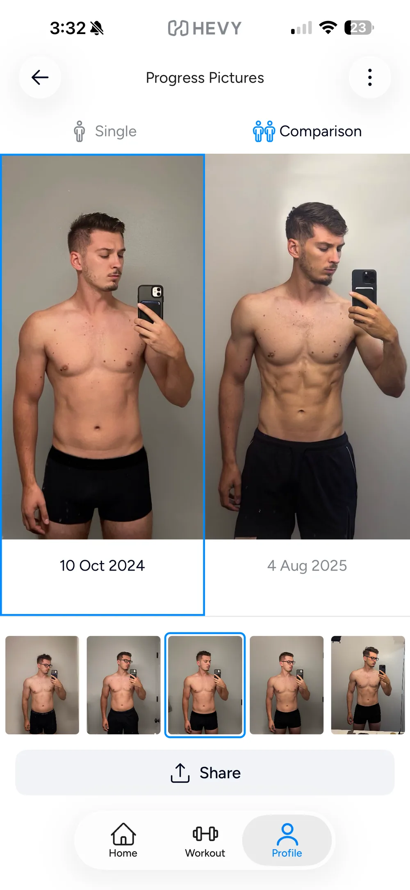
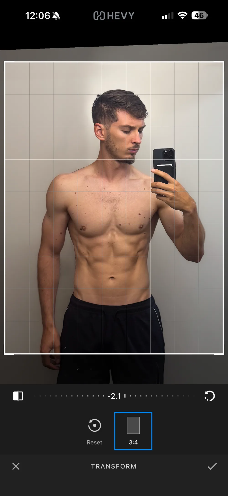
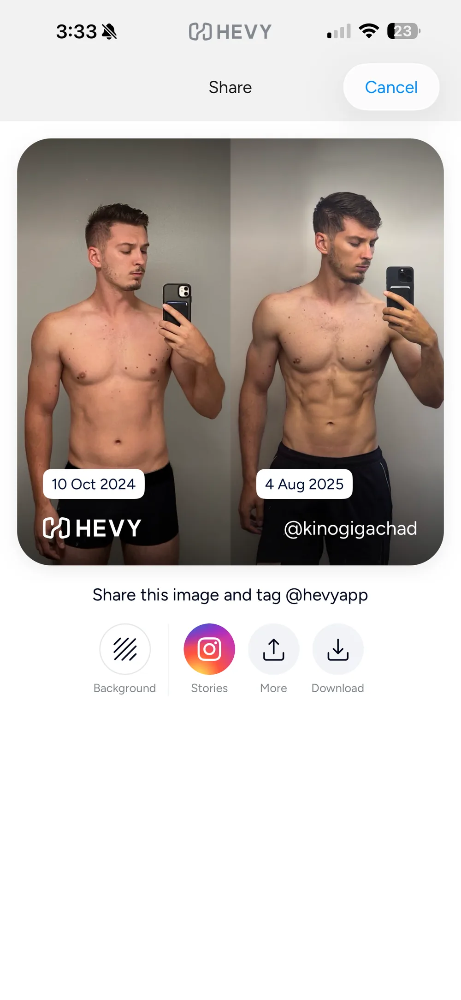

<!-- TODO(Mark): final title, seo_title and description once the verdict is written. Add card_blurb if the /blog/ card needs a shorter line. -->
<!-- TODO(Mark): set "published: YYYY-MM-DD" in the frontmatter and remove draft: true when this is ready. -->

<!-- Outline approved by Mark, in his chosen structure. Each point is word for word from the outline; write the prose from it. -->

## 1. Who it's for {#who-its-for}

If you already log workouts in Hevy, here's what its progress photos can and can't do.

**Full disclosure: I build Recomp, a free progress photo app, and I hold it to the same bar as every other app.** I don't run ads, and I don't use affiliate links.

Hevy is one of the 12 apps I've tested so far, and one of three fitness apps with a photo feature I tested alongside the dedicated progress photo apps. I tested it the way I test every app, with real photos and weights from my own transformation. [How I review progress photo apps](/blog/how-i-test-progress-photo-apps/) explains the method.

- Who it's for: <mark class="rounded-sm bg-yellow-200 px-1 text-black box-decoration-clone">[TODO]</mark> (suggestion: people already logging workouts in Hevy who want a simple weekly photo next to their weight).

## 2. Hevy vs Recomp {#hevy-vs-recomp}

- Hevy is a workout tracker with progress photos under Profile → Measures.
- What it has: capture overlay in the camera, progress photo comparisons, photos next to your measurements.
- Both have a capture overlay, side-by-side comparisons, and photos with data.
- Biggest drawbacks: one photo per day, no auto-align, no alignment after a check-in, doesn't read the date from the photo.
- The differences come from the drawbacks (photos per day, alignment, photo dates).

## 3. Four questions {#four-questions}

### Photo app (camera roll) {#photo-album}

- Photos go edge to edge in side-by-side view.
- Not edge to edge in single view.

{.phone}

### Alignment app {#alignment}

- Manual alignment during upload only.
- You can manually align in compare view but it isn't saved.
- Overlay for the in-app camera only.
- No overlay for imported photos, no auto-align, no side-by-side alignment.
- No alignment after check-in, and realigning means deleting the entry, which deletes its weight and measurements.

{.phone}

### Collage app {#compare}

- Basic compare view, basic share view.
- No slider, no overlay view, no timelapse.
- No alignment in the share view.

{.phone}

### Data app {#data}

- Photos next to weight and measurements.
- Only one photo per day, so no front, side and back under the same date.
- Doesn't get the date from the photo.
- Some measurements free (weight and waist), the rest paid.
- Exports measurement data but not photos.

## 4. A note on sharing {#sharing}

- Photos in Measures stay private even if your profile is public.
- Media attached to a shared workout is different from Measures photos and others can see it, so if you use Hevy's social side, know which one you're posting.
- Links: [Hevy's help article on measurements and progress photos](https://help.hevyapp.com/hc/en-us/articles/35385479603479-Body-Composition-Tracking-Measurements-and-Progress-Photos) and [Hevy's progress photos feature page](https://www.hevyapp.com/features/progress-photos/).

## 5. Verdict {#verdict}

- Verdict line: <mark class="rounded-sm bg-yellow-200 px-1 text-black box-decoration-clone">[TODO]</mark>.
- Verdict: <mark class="rounded-sm bg-yellow-200 px-1 text-black box-decoration-clone">[TODO]</mark>, qualitative with no score.

## 6. Dates {#when-tested}

- Dates: published plus tested (<mark class="rounded-sm bg-yellow-200 px-1 text-black box-decoration-clone">[TODO]</mark>).
- Published: <!-- TODO(Mark): publish date (also set "published:" in the frontmatter). -->
- Tested: <mark class="rounded-sm bg-yellow-200 px-1 text-black box-decoration-clone">[TODO]</mark>

There's no promise of when this page will be updated. If you think I got something wrong, email me at support@progressphotos.app.
