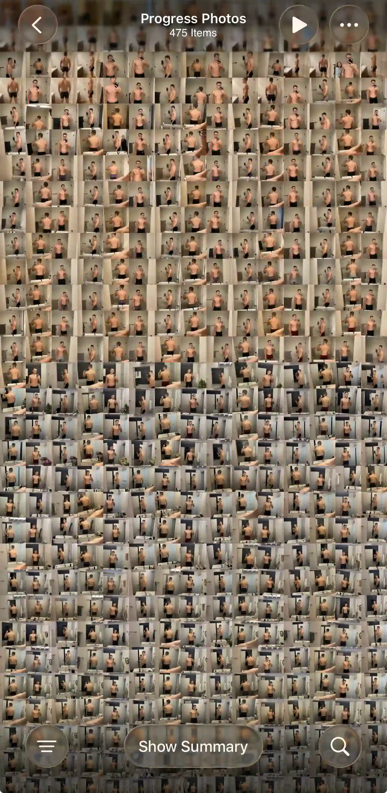

**Full disclosure: I build Recomp, a free progress photo app.**

<!-- app-store-card -->

## Built for workouts, not photos {#design-tradeoffs}

If you’re one of the many people who already use the popular workout tracking app Hevy, you’re probably wondering if you really need to download and set up a whole new app. And yes, while Hevy does have progress photo tracking, it makes multiple tradeoffs to optimize for workouts over photo tracking.

Apple’s native apps are a perfect case study for why it makes sense to separate apps that can seem closely related.

- Camera and Photos
- Health and Fitness
- Notes and Numbers

Separating these apps provides a better user experience for each individual use case. We recommend using multiple apps and tools, each designed for a specific use case. At the very least, you need a workout tracker, a calorie tracker, and a progress photo tracker.

## How I test {#how-i-test}

After personally tracking hundreds of progress photos over several years, I have an opinionated philosophy on what's a must-have, what's nice-to-have, and what's fluff. A great progress photo tracker is four apps in one:

1. Photos app / camera roll
2. Great alignment tools for consistent comparisons
3. Collage app with multiple ways to compare your photos over time
4. Weight, measurements, and notes all associated with photos

I test each of these features with my personal library of real progress photos and weight records. See [How I review progress photo apps](/blog/how-i-test-progress-photo-apps/) to learn more.

{.phone}

## Adding progress data {#adding-data}

### No notifications for tracking {#reminders}

Hevy's notifications are workout-specific, like a rest timer in between sets and the monthly training report, as well as social notifications for new followers, likes, and comments. Sources: [Hevy's notification settings](https://help.hevyapp.com/hc/en-us/articles/33845807003671-Account-Settings-Preferences-Profile-Information-Adjust-username-password-or-email-address-Notifications).

### Photos {#adding-photos}

Hevy's **1 photo/day limit** means you can't keep front, side and back photos on the same day. Sources: [Hevy's progress photos page](https://www.hevyapp.com/features/progress-photos/).

Hevy supports both adding existing photos and an in-app camera. Hevy doesn't read the date from the photo, so you must edit the date manually if you're adding a photo from a different date.

### Weights and measurements {#weights}

Hevy syncs your weight with Apple Health and tracks a long list of measurements. The photo, your weight, and your waist are free. The other 15 measurements are on the paid plan. [Hevy's Apple Health help](https://help.hevyapp.com/hc/en-us/sections/36957443687831-Apple-Health).

{.phone}

{.phone}

{.phone}

{.phone}

## Alignment {#alignment}

Once a photo is added, its alignment is locked. Sometimes you're in a rush, don't line up properly, and only notice a week or two later, when it's too late.

Your alignment options depend on how you add the photo.

**In-app camera.** A faded ghost of your last photo sits over the live view, so you can match your pose and distance to last week. The camera has no zoom, and there's no alignment step after you take the shot.

**Camera roll.** You get a Transform step with crop, rotate, pan and zoom before saving. That's your only chance. There's no overlay, and Hevy doesn't read the photo's date, so you type in when each one was taken.

**Existing photos.** None. Once a check-in is saved, you can't adjust it.

There's no auto-align or side-by-side alignment either, and the tools aren't consistent between the camera and the camera roll.

{.phone}

{.phone}

## Comparison Features {#compare}

Hevy has single and side-by-side views with a thumbnail strip along the bottom for easy switching. It lacks a full-screen view for a single photo like in the Photos app. It doesn't have a slider view, overlay, or timelapse.

{.phone}

{.phone}

{.phone}

## Quality of life and privacy {#sharing}

**Your photos are uploaded to Hevy's servers, rather than stored only on your phone.** Hevy's help says everything is stored in your profile on its servers, which is why reinstalling the app doesn't lose them and why you need an account. Hevy's App Store privacy label doesn't list photos among the data it collects. Sources: [Hevy's help on reinstalling](https://help.hevyapp.com/hc/en-us/articles/38223672272791-What-will-happen-to-my-information-if-I-uninstall-and-reinstall-the-Hevy-app) and the [App Store listing](https://apps.apple.com/us/app/id1458862350).

Photos in Measures stay private even if your profile is public. Photos or videos you attach to a shared workout are different, and other people can see them. If you use Hevy's social side, know which one you're posting. Sources: [Hevy's help article on measurements and progress photos](https://help.hevyapp.com/hc/en-us/articles/35385479603479-Body-Composition-Tracking-Measurements-and-Progress-Photos) and [Hevy's progress photos feature page](https://www.hevyapp.com/features/progress-photos/).

Hevy has a dark theme. I didn't find an app lock or Face ID option in its help, so hiding the photos means using iOS's own Require Face ID on the app icon. [Hevy's theme setting](https://www.hevyapp.com/help/change-the-theme-android-ios/).

Hevy exports your measurements as a CSV, but your photos aren't in the export.

## My verdict on Hevy's progress photos {#verdict}

**Hevy is fine for one weekly photo if you already train in the app**, but one photo per day, alignment that locks after save, and comparison limits make it a poor fit if photos are central to your cut or bulk. Use a dedicated progress photo app if you want multiple angles per check-in, saved alignment, and richer comparisons.

## FAQ {#faq}

### Can you add front, side and back photos on the same day in Hevy? {#faq-same-day}

No. Hevy allows one progress photo per day.

### Can other people see my Hevy progress photos? {#faq-privacy}

No. Photos in Measures stay private even with a public profile. Photos or videos you attach to a workout are visible.

### Are Hevy body measurements free? {#faq-measurements}

Weight and waist are free. Body fat and the other measurements need Hevy Pro.

### Can you export progress photos from Hevy? {#faq-export}

You can share a single-photo or side-by-side image. The measurements CSV doesn't include your photos.

### Does Hevy remind you to take progress photos? {#faq-reminders}

No. Hevy's notifications cover workouts and social activity, not progress photos or weigh-ins.

<!-- scorecard -->
