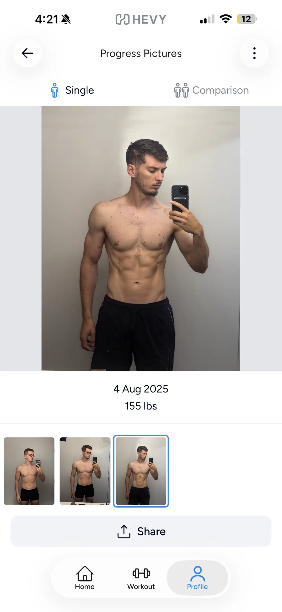
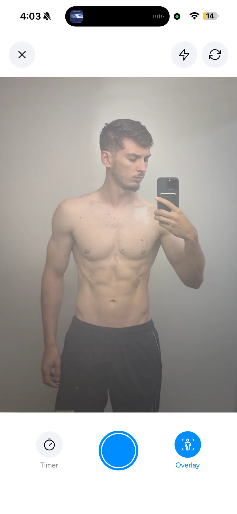
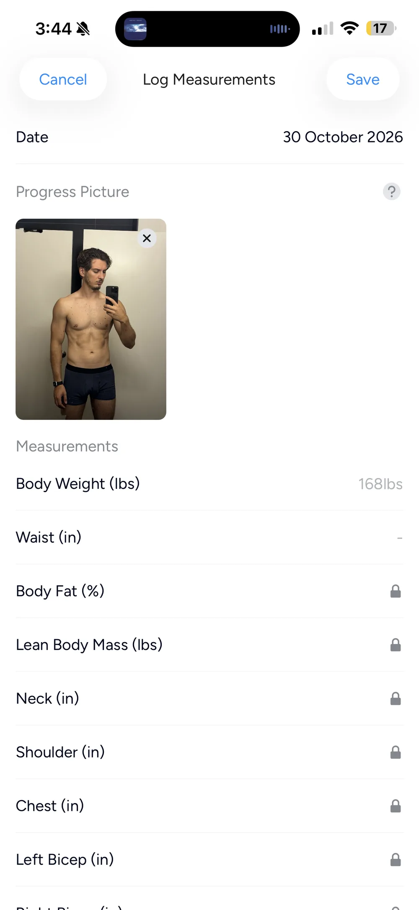
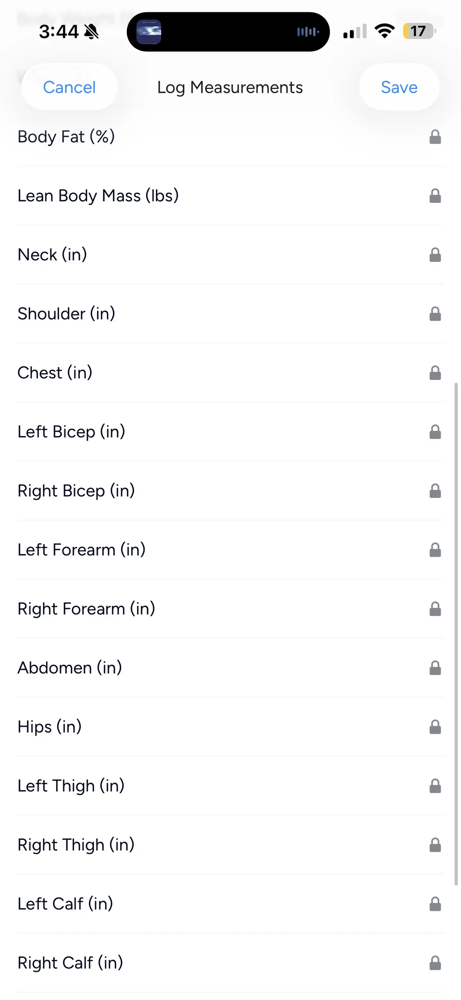

## Summary {#summary}

Hevy is a workout tracker with progress photos built in, under Profile > Measures. It has an overlay in the capture camera, side-by-side progress photo comparisons, and photos next to your weight and measurements. The biggest drawbacks: only one photo per day, so front, side and back can't share a date; no auto-align; no way to align after a check-in without deleting the entry and its weight and measurements; and you set the date by hand.

**Verdict:** <!-- TODO(Mark): verdict. -->

## Who should use Hevy for progress photos? {#who-its-for}

If you already log workouts in Hevy, here's what its progress photos can and can't do.

<!-- TODO(Mark): who should use it and who shouldn't. Suggestion: people already logging workouts in Hevy who want a simple weekly photo next to their weight. -->

I used Hevy for my workouts (see [Why I built Recomp](/blog/why-i-built-recomp/)). <!-- TODO(Mark): confirm wording. -->

Full disclosure: I build Recomp, a progress photo app. <!-- TODO(Mark): method paragraph and link to How I Review (check the "12 apps I've tested so far" count). -->

## Hevy vs Recomp for progress photos {#hevy-vs-recomp}

- Both have a capture overlay, side-by-side comparisons, and photos kept with your data.
- Where they differ: photos per day, alignment, and photo dates (details below).

## Is Hevy good for taking progress photos? {#photo-album}

- Photos go edge to edge in the side-by-side view.
- Photos don't go edge to edge in the single view.

{.phone}

{.phone}

## Is Hevy good for aligning progress photos? {#alignment}

- Overlay for the in-app camera only.
- Manual alignment during upload only.
- Possible to manually align in the compare view, but the alignments aren't persisted.
- No overlay for imported photos, no auto alignment, no side-by-side alignment.
- No alignment after check-in. To align, you have to delete the image record, which includes the weight and measurement data.

{.phone}

{.phone}

<!-- TODO(Mark): image needed: compare view alignment resetting after reopening. -->

<!-- TODO(Mark): image needed: delete prompt on an entry. -->

<!-- TODO(Mark): does "replace it" (per Hevy's help article) let you realign without deleting weight and measurements? -->

## Can Hevy make a before and after? {#compare}

- Basic compare view.
- Basic share view.
- No slider view, no overlay view, no timelapse.
- No alignment in the share view.

{.phone}

## Does Hevy keep photos with your weight and measurements? {#data}

- Photos sit next to your weight and measurements.
- Only one photo per day, so no front, side and back saved under the same date.
- You set the date by hand.
- Some measurements are free (weight and waist). The rest are paid.
- Exports measurement data but not photos.

{.phone}

{.phone}

<!-- TODO(Mark): image needed: second photo on the same date blocked. -->

<!-- TODO(Mark): image needed: imported photo landing on today's date. -->

<!-- TODO(Mark): image needed: export screen without photos. -->

## Who can see your Hevy progress photos? {#sharing}

Photos in Measures stay private even if your profile is public. Media you attach to a shared workout is a different thing and others can see it, so if you use Hevy's social side, know which one you're posting.

Sources: [Hevy's help article on measurements and progress photos](https://help.hevyapp.com/hc/en-us/articles/35385479603479-Body-Composition-Tracking-Measurements-and-Progress-Photos), [Hevy's progress photos feature page](https://www.hevyapp.com/features/progress-photos/).

## My verdict on Hevy's progress photos {#verdict}

<!-- TODO(Mark): verdict (qualitative, no score). -->

## FAQ {#faq}

**Can you add front, side and back photos on the same day in Hevy?**\
No. Hevy allows one progress photo per day.

**Can other people see my Hevy progress photos?**\
No. Photos in Measures stay private even with a public profile. Photos or videos you attach to a workout are visible.

**Are Hevy body measurements free?**\
Weight and waist are free. Body fat and the other measurements need Hevy Pro.

**Can you export progress photos from Hevy?**\
Hevy exports measurements as a CSV. Photos aren't in the export.

---

Published: <!-- TODO(Mark): publish date (also set "published:" in the frontmatter and remove draft: true). -->\
Tested: <!-- TODO(Mark): tested date (October 2026?); also set tested: in the frontmatter. --> {#when-tested}

Questions or corrections: support@progressphotos.app
