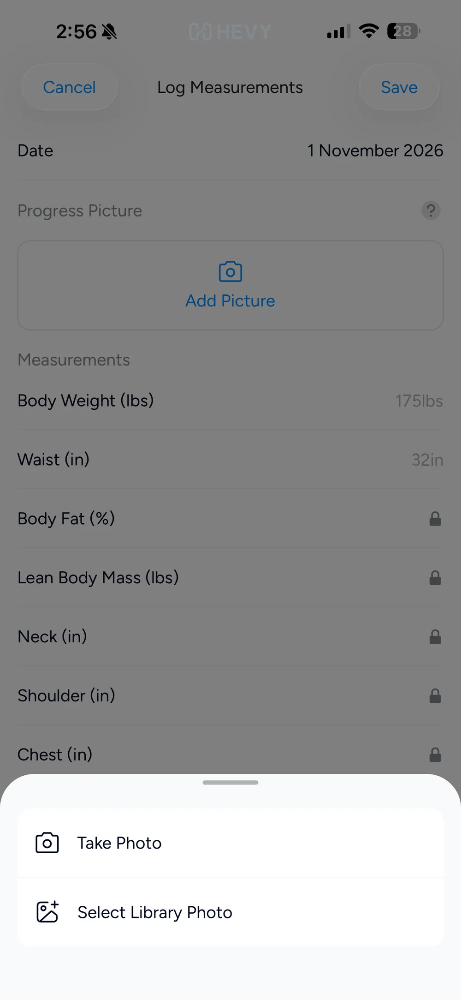
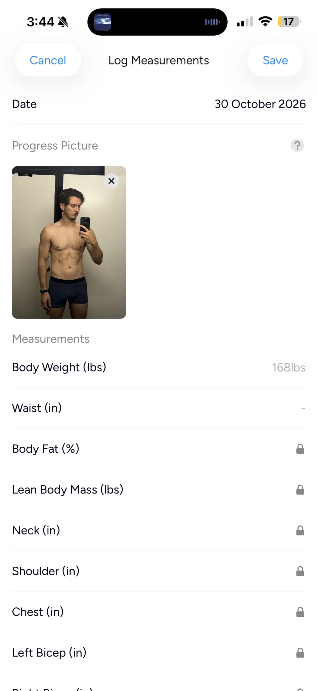
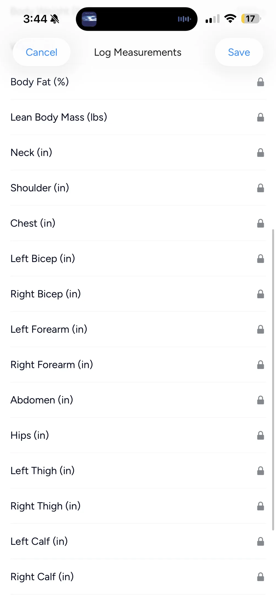
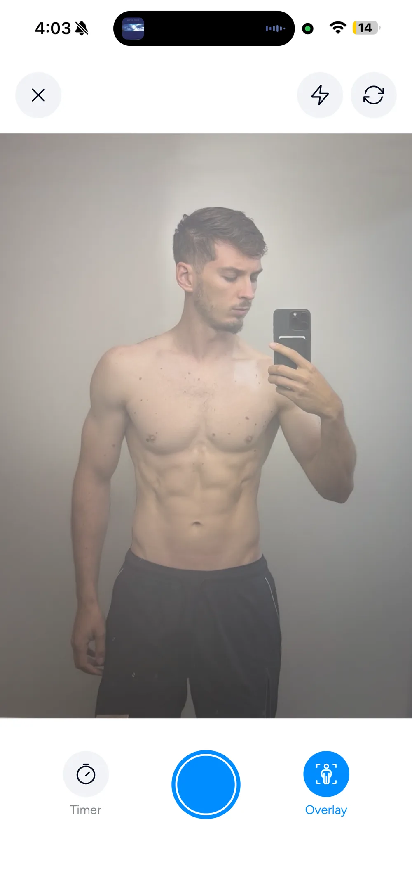
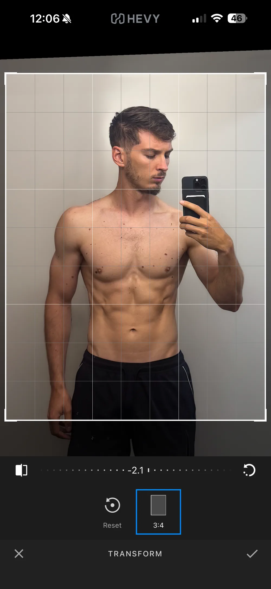
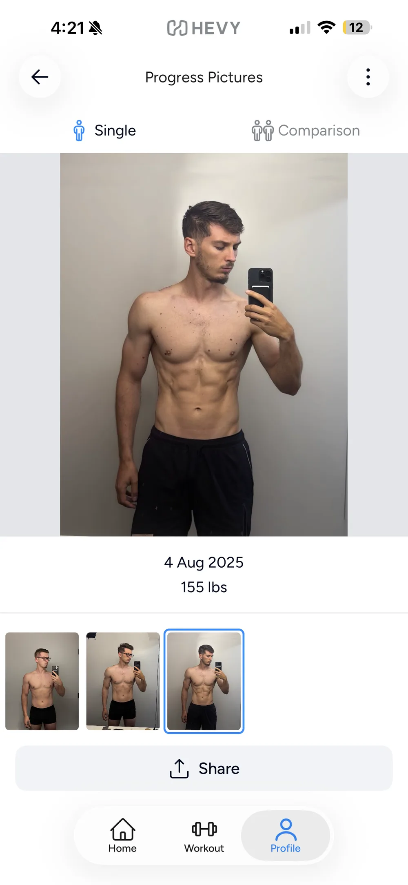
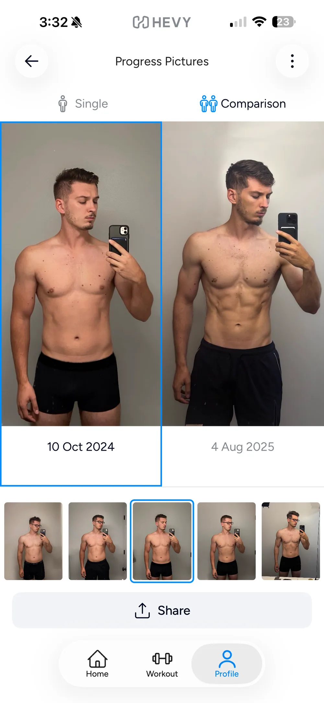
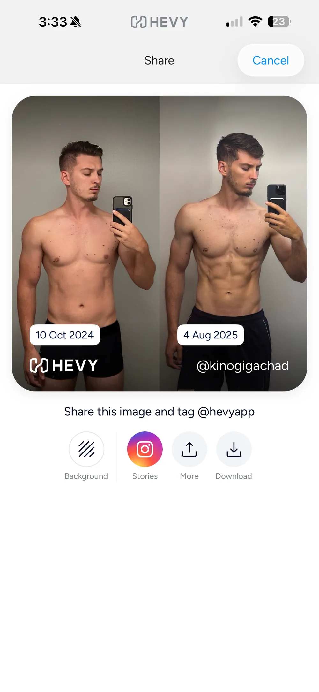

**Full disclosure: I build Recomp, a free progress photo app.**

<!-- app-store-card -->

Hevy is one of the 12 apps I've tested so far, and one of three fitness apps with a photo feature I tested alongside the dedicated progress photo apps. I tested it the way I test every app, with real photos and weights from my own transformation. [How I review progress photo apps](/blog/how-i-test-progress-photo-apps/) explains the method.

## Built for workouts, not photos {#design-tradeoffs}

<!-- TODO: outline, write into prose -->

1. Hevy is one of the best and most popular workout trackers.
2. Every design decision in Hevy serves workout tracking. That's the app's priority.
3. Photo and weight tracking aren't a priority.
4. Designing an app means making trade-offs.
5. If you optimize for workout tracking, you can't also optimize for photo tracking.
6. Apple's own apps show this. Calendar, Reminders, Photos, Calculator, Notes and Health are all separate apps.
7. Each of those apps is optimized for a different job, and that's why Apple split them up.
8. Apple could combine them into one app. Separate apps are just much more usable.

Apple keeps each pair separate because each app is optimized for a different job:

- Camera and Photos both handle your pictures.
- Health and Fitness both track your body. It could combine them into one app. They're just much easier to use apart.
- Notes and Numbers are both pages you type into.

A progress photo app is really four apps in one: a camera roll, an alignment app, a collage app for comparisons, and a data app that keeps photos with your weight and measurements. Hevy is a workout tracker first, and its photos live under Profile > Measures. Here's how each of the four holds up through a normal weekly check-in.

## Adding your progress data {#adding-data}

### The morning reminder {#reminders}

**Hevy doesn't remind you to take progress photos or weigh in.** Its notification settings cover the rest timer, new followers, the monthly training report, emails, likes and comments. None of them is for photos, weight or measurements, so the weekly check-in reminder has to come from your own calendar. [Hevy's notification settings](https://help.hevyapp.com/hc/en-us/articles/33845807003671-Account-Settings-Preferences-Profile-Information-Adjust-username-password-or-email-address-Notifications).

### Adding photos {#adding-photos}

**Hevy allows only one photo per day, so front, side and back can't share a date.** Hevy's own suggestion is to spread the set over three days in a row, one photo per day. [Hevy's progress photos page](https://www.hevyapp.com/features/progress-photos/).

**From the camera roll.** Picking an existing photo works, but Hevy doesn't read the date from the photo. You set each photo's date by hand, so importing an old photo means typing in when you took it. Unlike the in-app camera, there's no overlay here.

For camera roll photos, you can crop, rotate, pan and zoom before saving. That's the only chance you get. Photos from the in-app camera can't be aligned at all after you take the shot, and the alignment tools aren't consistent between the camera and the camera roll. The next section covers why.

### Weights and measurements {#weights}

**Each photo sits next to your weight and measurements, which is what a data app should do.** Hevy's Apple Health help only covers sending workouts to Health. I didn't find a way to read weight from a smart scale, so every weigh-in is typed in by hand. [CONFIRM: in iPhone Settings > Health > Data Access & Devices > Hevy, is there a read permission for Body Mass?] [Hevy's Apple Health help](https://help.hevyapp.com/hc/en-us/sections/36957443687831-Apple-Health).

Weight and waist are free. Body fat and the other measurements need Hevy Pro.

{.phone}

{.phone}

{.phone}

{.phone}

## Alignment {#alignment}

**There's no alignment after you add a photo.** Once the check-in is saved, there's no way to adjust it. If the alignment is off, you have to delete the photo and retake or re-upload it. If you took it with the in-app camera, there's no going back: you're locked in, and you may only notice the problem weeks later. [CONFIRM: Hevy's help article mentions "replace it". Does that let you realign without losing the entry?]

There's also no auto-align, no side-by-side alignment, and no overlay when you pick a photo from the camera roll.

What Hevy does have: the in-app camera's overlay, and a Transform step with crop, rotate, pan and zoom before you save a camera roll photo. In-app camera shots skip that step, so there's no alignment after you snap the photo.

**In-app camera overlay.** The camera shows a faded ghost of your last photo over the live view, so you can match your pose and distance to last week. The camera has no zoom.

{.phone}

{.phone}

## Comparing with last month {#compare}

**The single view doesn't let the photos go edge to edge.** The photo sits between grey bars and doesn't fill the width, and there's no full-screen photo viewer.

The side-by-side view is better. Both photos fill the screen edge to edge.

{.phone}

{.phone}

Alignment comes up again here. You can manually align two photos in the compare view, but the alignment isn't saved, so next week you start over.

For sharing, you pick two dates and share them side by side as an image. There's no slider, no overlay view and no timelapse, and you can't adjust alignment in the share view.

{.phone}

## Quality of life and privacy {#sharing}

**Your photos are uploaded to Hevy's servers, not kept on your phone.** Hevy's help says everything is stored to your profile on its servers, which is why reinstalling the app doesn't lose them and why you need an account. Hevy's App Store privacy label doesn't list photos among the data it collects. [Hevy's help on reinstalling](https://help.hevyapp.com/hc/en-us/articles/38223672272791-What-will-happen-to-my-information-if-I-uninstall-and-reinstall-the-Hevy-app) and the [App Store listing](https://apps.apple.com/us/app/id1458862350).

Photos in Measures stay private even if your profile is public. Photos or videos you attach to a shared workout are different, and other people can see them. If you use Hevy's social side, know which one you're posting. Sources: [Hevy's help article on measurements and progress photos](https://help.hevyapp.com/hc/en-us/articles/35385479603479-Body-Composition-Tracking-Measurements-and-Progress-Photos) and [Hevy's progress photos feature page](https://www.hevyapp.com/features/progress-photos/).

Hevy has a dark theme. I didn't find an app lock or Face ID option in its help, so hiding the photos means using iOS's own Require Face ID on the app icon. [Hevy's theme setting](https://www.hevyapp.com/help/change-the-theme-android-ios/).

Hevy exports your measurements as a CSV, but your photos aren't in the export.

## My verdict on Hevy's progress photos {#verdict}

[TODO] Suggested starting point: Hevy's photos work as a quick weekly snapshot next to your weight, and the camera overlay helps you match last week's pose. If you take front, side and back, or want to fix alignment later, it gets in the way.

## FAQ {#faq}

### Can you add front, side and back photos on the same day in Hevy? {#faq-same-day}

No. Hevy allows one progress photo per day.

### Can other people see my Hevy progress photos? {#faq-privacy}

No. Photos in Measures stay private even with a public profile. Photos or videos you attach to a workout are visible.

### Are Hevy body measurements free? {#faq-measurements}

Weight and waist are free. Body fat and the other measurements need Hevy Pro.

### Can you export progress photos from Hevy? {#faq-export}

Hevy exports measurements as a CSV. Photos aren't in the export.

### Does Hevy remind you to take progress photos? {#faq-reminders}

No. Hevy's notifications cover workouts and social activity, not progress photos or weigh-ins.

<!-- scorecard -->

---

Published: [TODO]

Tested: [TODO] (October 2026?) {#when-tested}

Questions or corrections: support@progressphotos.app
