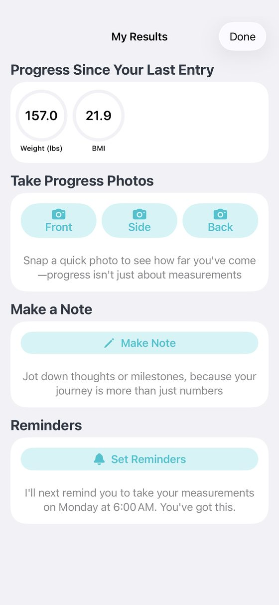
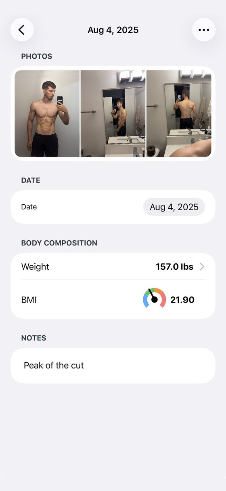
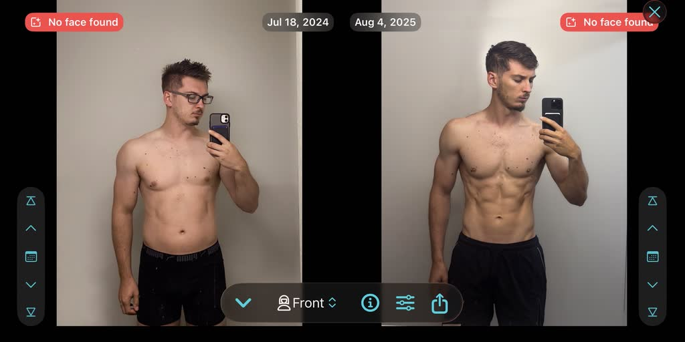
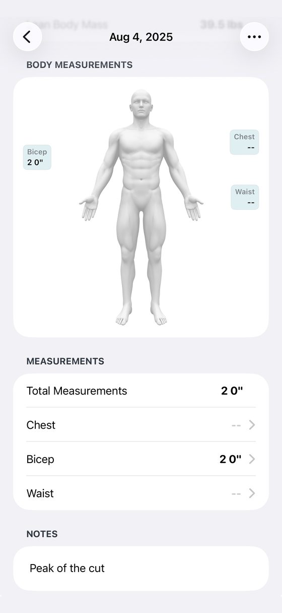
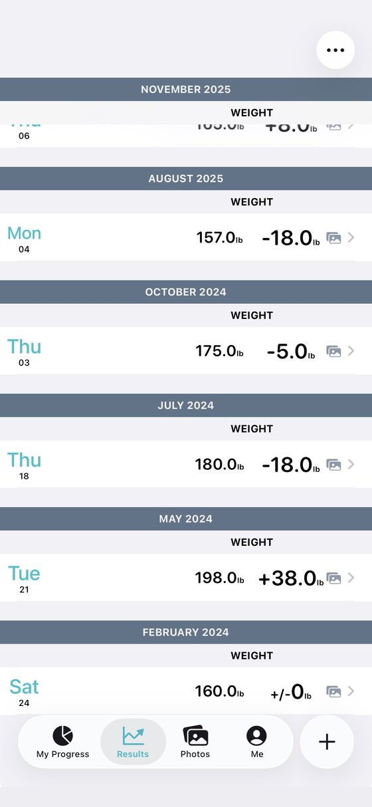

<!-- TODO(Mark): no "sameAs" on the author node yet. /about/ and the site link no X, Instagram, LinkedIn or GitHub profile for Mark. Add it here and on /about/ once one is public. -->

**Full disclosure: I build Recomp, a free progress photo app that competes with this one.** No app pays me <mark class="rounded-sm bg-yellow-200 px-1 text-black box-decoration-clone">\[CONFIRM: no ads, affiliate links or partner deals\]</mark>. This review expands the [Lasmit entry](/blog/best-progress-photo-apps/#lasmit) in my [roundup of the best progress photo apps](/blog/best-progress-photo-apps/), scored with [the same kit](/blog/how-i-test-progress-photo-apps/).

## What it costs {#what-it-costs}

**Lasmit is free to download, but progress photos need Pro.** Its listing says "Pro unlocks progress photos, unlimited measurement areas, custom reports, past-data entry, and more." The store lists $3.99 and $5.99 a month, $11.99 and $19.99 a year, and $29.99 lifetime. <mark class="rounded-sm bg-yellow-200 px-1 text-black box-decoration-clone">\[TODO: which monthly price a new user sees\]</mark>

**A Sep 24, 2026 review says a "lifetime" purchase now needs an annual plan to log more than four measurements.** I haven't checked that against the current paywall. <mark class="rounded-sm bg-yellow-200 px-1 text-black box-decoration-clone">\[CONFIRM: lifetime vs annual measurement limit\]</mark>

## Taking a check-in {#taking-a-check-in}

**I proposed 3 out of 5 for capture.** It has a nice weight scroller and a timer, but a single check-in is a multi-page form. That's the opposite of a check-in you'll repeat every week. <mark class="rounded-sm bg-yellow-200 px-1 text-black box-decoration-clone">\[TODO: seconds and taps to a saved check-in\]</mark>

<figure class="m-0 min-w-0 flex-1"><figcaption class="mt-[0.65rem] text-center text-caption leading-[1.4] text-muted">My Results: weight, BMI and photo buttons.</figcaption></figure><figure class="m-0 min-w-0 flex-1"><figcaption class="mt-[0.65rem] text-center text-caption leading-[1.4] text-muted">One check-in: photos, weight, BMI and a note.</figcaption></figure>

## Lining photos up {#lining-photos-up}

**I proposed 0 for alignment, because there is none.** Its Smart Overlay has been off by default since version 2026.5 on Feb 3, 2026. The release note says "when it didn't work, it was causing a lot of confusion." <mark class="rounded-sm bg-yellow-200 px-1 text-black box-decoration-clone">\[CONFIRM: whether it aligns anything when switched on\]</mark> <mark class="rounded-sm bg-yellow-200 px-1 text-black box-decoration-clone">\[TODO: the rubric floor is 1; use 0 or 1?\]</mark>

## Comparing two dates {#comparing-two-dates}

**I proposed 2 for comparison.** Side by side works in landscape only, with a date stepper on each side, so you step through dates one at a time. It's awkward, and not the best UI. The same 2026.5 update added a jump to any photo by date in compare. <mark class="rounded-sm bg-yellow-200 px-1 text-black box-decoration-clone">\[TODO: seconds to put the oldest and newest front photos side by side\]</mark>

## Measurements and Apple Health {#measurements-and-apple-health}

**Measurements are where Lasmit earns its place.** It tracks 17 body measurements plus up to 10 custom ones. Apple Health sync runs both ways: it reads weight, body fat and waist, and writes weight, body fat, lean body mass, waist and BMI. It also imports your past Apple Health data. Fitbit support was removed in 2026.22 on Sep 22, 2026.

**Its reviewers care more about measurements than photos.** In my [study of 732 App Store reviews](/blog/what-people-want-from-progress-photo-apps/), 511 are Lasmit's. Of those, 220 mention measurements and 125 mention photos. Seven complain that it won't calculate body fat from tape or caliper numbers.

<figure class="m-0 min-w-0 flex-1"><figcaption class="mt-[0.65rem] text-center text-caption leading-[1.4] text-muted">Body measurements.</figcaption></figure><figure class="m-0 min-w-0 flex-1"><figcaption class="mt-[0.65rem] text-center text-caption leading-[1.4] text-muted">Weigh-ins by month.</figcaption></figure>

## Importing old photos {#importing-old-photos}

**I found no bulk photo import and no date-from-metadata in Lasmit's public docs.** Photos taken in the app stay in the app, and you can save one to your phone by hand, per a 2019 help article. <mark class="rounded-sm bg-yellow-200 px-1 text-black box-decoration-clone">\[TODO: hands-on import test\]</mark>

## Where your photos live {#where-your-photos-live}

**Photos and measurements sync to your own iCloud once you switch Progress on in iOS Settings.** Its help article, updated Oct 14, 2025, says your data then survives deleting the app or getting a new phone. Version 2026.7 on Feb 27, 2026 fixed "an issue that was affecting moving your data between devices."

**The label says Data Not Linked to You, and the policy names more.** It lists Mixpanel, Firebase Remote Config, Crashlytics, RevenueCat, HealthKit and TestFlight. It also names Vero, which collects your email and first name, and Help Scout for support, and the label mentions neither. An app lock setting exists but didn't block anything for me. <mark class="rounded-sm bg-yellow-200 px-1 text-black box-decoration-clone">\[CONFIRM: exact app-lock behavior\]</mark>

**Lost data shows up in its reviews.** A Dec 2025 review is titled "Lost FIVE YEARS of data in latest upgrade." <mark class="rounded-sm bg-yellow-200 px-1 text-black box-decoration-clone">\[TODO: iCloud delete-and-restore test\]</mark>

## What reviewers say {#what-reviewers-say}

**Reminders are what Lasmit's reviewers thank it for.** Of the 37 reviews in my study that mention reminders, 19 positive ones are Lasmit's. One reads: "The reminders are helpful but not intrusive." Four of the five reminder complaints are Lasmit's too, including one that "would not stick to the requested reminder schedule."

## Scores so far {#scores-so-far}

<table class="w-max min-w-full border-collapse text-left text-micro">
<thead>
<tr>
<th class="whitespace-nowrap border-b border-card-border px-3 py-2 align-bottom font-semibold text-fg" scope="col">Score (1 to 5)</th>
<th class="whitespace-nowrap border-b border-card-border px-3 py-2 align-bottom font-semibold text-fg" scope="col">Lasmit</th>
<th class="whitespace-nowrap border-b border-card-border px-3 py-2 align-bottom font-semibold text-fg" scope="col">Status</th>
</tr>
</thead>
<tbody>
<tr>
<th class="whitespace-nowrap border-b border-card-border px-3 py-2 align-top text-muted" scope="row">Capture and tracking</th>
<td class="border-b border-card-border px-3 py-2 align-top text-muted">3</td>
<td class="border-b border-card-border px-3 py-2 align-top text-muted">Proposed</td>
</tr>
<tr>
<th class="whitespace-nowrap border-b border-card-border px-3 py-2 align-top text-muted" scope="row">Alignment</th>
<td class="border-b border-card-border px-3 py-2 align-top text-muted">0</td>
<td class="border-b border-card-border px-3 py-2 align-top text-muted">Proposed; below the rubric floor of 1</td>
</tr>
<tr>
<th class="whitespace-nowrap border-b border-card-border px-3 py-2 align-top text-muted" scope="row">Comparison</th>
<td class="border-b border-card-border px-3 py-2 align-top text-muted">2</td>
<td class="border-b border-card-border px-3 py-2 align-top text-muted">Proposed</td>
</tr>
<tr>
<th class="whitespace-nowrap border-b border-card-border px-3 py-2 align-top text-muted" scope="row">Design</th>
<td class="border-b border-card-border px-3 py-2 align-top text-muted">TBD</td>
<td class="border-b border-card-border px-3 py-2 align-top text-muted"></td>
</tr>
<tr>
<th class="whitespace-nowrap border-b border-card-border px-3 py-2 align-top text-muted" scope="row">Performance</th>
<td class="border-b border-card-border px-3 py-2 align-top text-muted">TBD</td>
<td class="border-b border-card-border px-3 py-2 align-top text-muted"></td>
</tr>
<tr>
<th class="whitespace-nowrap border-b border-card-border px-3 py-2 align-top text-muted" scope="row">Privacy</th>
<td class="border-b border-card-border px-3 py-2 align-top text-muted">TBD</td>
<td class="border-b border-card-border px-3 py-2 align-top text-muted"></td>
</tr>
<tr>
<th class="whitespace-nowrap border-b border-card-border px-3 py-2 align-top text-muted" scope="row">Backup</th>
<td class="border-b border-card-border px-3 py-2 align-top text-muted">TBD</td>
<td class="border-b border-card-border px-3 py-2 align-top text-muted"></td>
</tr>
<tr>
<th class="whitespace-nowrap border-b border-card-border px-3 py-2 align-top text-muted" scope="row">Import (bonus, outside the total)</th>
<td class="border-b border-card-border px-3 py-2 align-top text-muted">TBD</td>
<td class="border-b border-card-border px-3 py-2 align-top text-muted"></td>
</tr>
<tr>
<th class="whitespace-nowrap border-b border-card-border px-3 py-2 align-top text-muted" scope="row">Total out of 35</th>
<td class="border-b border-card-border px-3 py-2 align-top text-muted">TBD</td>
<td class="border-b border-card-border px-3 py-2 align-top text-muted">5 from the three proposed</td>
</tr>
</tbody>
</table>

<mark class="rounded-sm bg-yellow-200 px-1 text-black box-decoration-clone">\[CONFIRM: rescore on the v8 rubric or the Oct 4 measured tiers; v7 provisional grade was B, 16/25. Beginner all-in-one label.\]</mark>

## The numbers {#the-numbers}

**Every app's numbers sit side by side, with test dates, in [my test data](/blog/how-i-test-progress-photo-apps/#store-data).**

<table class="w-max min-w-full border-collapse text-left text-micro">
<thead>
<tr>
<th class="whitespace-nowrap border-b border-card-border px-3 py-2 align-bottom font-semibold text-fg" scope="col">Field</th>
<th class="whitespace-nowrap border-b border-card-border px-3 py-2 align-bottom font-semibold text-fg" scope="col">Value</th>
</tr>
</thead>
<tbody>
<tr>
<th class="whitespace-nowrap border-b border-card-border px-3 py-2 align-top text-muted" scope="row">Full name</th>
<td class="border-b border-card-border px-3 py-2 align-top text-muted">Body Measurements Tracker App, "Progress" (Lasmit)</td>
</tr>
<tr>
<th class="whitespace-nowrap border-b border-card-border px-3 py-2 align-top text-muted" scope="row">Rating</th>
<td class="border-b border-card-border px-3 py-2 align-top text-muted">4.63 from 9,355 US ratings (Oct 3, 2026)</td>
</tr>
<tr>
<th class="whitespace-nowrap border-b border-card-border px-3 py-2 align-top text-muted" scope="row">Written reviews, Jul 2 to Oct 2, 2026</th>
<td class="border-b border-card-border px-3 py-2 align-top text-muted">5 (US feed)</td>
</tr>
<tr>
<th class="whitespace-nowrap border-b border-card-border px-3 py-2 align-top text-muted" scope="row">Written reviews in Apple's feed</th>
<td class="border-b border-card-border px-3 py-2 align-top text-muted">511 in my study (Oct 2, 2026)</td>
</tr>
<tr>
<th class="whitespace-nowrap border-b border-card-border px-3 py-2 align-top text-muted" scope="row">First released</th>
<td class="border-b border-card-border px-3 py-2 align-top text-muted">Dec 17, 2012</td>
</tr>
<tr>
<th class="whitespace-nowrap border-b border-card-border px-3 py-2 align-top text-muted" scope="row">Last updated</th>
<td class="border-b border-card-border px-3 py-2 align-top text-muted">Sep 22, 2026</td>
</tr>
<tr>
<th class="whitespace-nowrap border-b border-card-border px-3 py-2 align-top text-muted" scope="row">Version tested</th>
<td class="border-b border-card-border px-3 py-2 align-top text-muted">2026.22 <mark class="rounded-sm bg-yellow-200 px-1 text-black box-decoration-clone">[CONFIRM]</mark></td>
</tr>
<tr>
<th class="whitespace-nowrap border-b border-card-border px-3 py-2 align-top text-muted" scope="row">Requires</th>
<td class="border-b border-card-border px-3 py-2 align-top text-muted">iOS 18.0+ on iPhone, plus Vision Pro; no iPad, Mac or Android</td>
</tr>
<tr>
<th class="whitespace-nowrap border-b border-card-border px-3 py-2 align-top text-muted" scope="row">App Store</th>
<td class="border-b border-card-border px-3 py-2 align-top text-muted"><a href="https://apps.apple.com/us/app/body-measurements-tracker-app/id583840813">Body Measurements Tracker App on the App Store</a></td>
</tr>
</tbody>
</table>

<mark class="rounded-sm bg-yellow-200 px-1 text-black box-decoration-clone">\[TODO: the roundup calls Lasmit's 5 recent written reviews "the most here," but GainFrame also had 5 in the same window.\]</mark>

## Who should use something else {#who-should-use-something-else}

**If photos are your main record, Lasmit is the wrong shape.** For a check-in you can repeat in a minute and a better compare screen, see my [Thumbstone review](/blog/thumbstone-review/) or [Then &amp; Now review](/blog/then-and-now-review/). For a one-time price with iCloud sync, see [Fit-Stitch](/blog/fit-stitch-review/).

## What I haven't tested yet {#what-i-havent-tested-yet}

**I still need design, performance, privacy, backup and import scores, and an iCloud restore.** I also need to see what Smart Overlay does when it's on. If Lasmit's Smart Overlay works for you, email me at [support@progressphotos.app](mailto:support@progressphotos.app).

<!-- chrome:author-bio depth="2" -->
<aside
class="mt-12 flex flex-wrap items-center gap-4 rounded-card border border-card-border bg-card px-[1.4rem] py-[1.35rem] sm:flex-nowrap sm:items-start"
aria-labelledby="author-bio-heading"
>
<!-- TODO(Mark): pick a photo. Replace this div with . The 64×64 box is reserved so nothing shifts. -->

<mark class="rounded-sm bg-yellow-200 px-1 text-black box-decoration-clone">TODO photo</mark>

<h2 id="author-bio-heading" class="min-w-0 flex-1 text-h4 font-bold tracking-h4">About the author</h2>

<strong class="text-fg">I'm Mark Stepchin, and I make Recomp, so read what I say about other apps with that in mind.</strong>
I'm a software engineer who has worked at Silicon Valley startups, with some time at Apple.
I've trained for years: I bulked from 145 to 195 lb, cut to 155, and now sit around 165.
Before building Recomp in my evenings and weekends from San Diego, I tried more than 10 progress photo apps.
<a href="../../about/">More about me</a>

<!-- TODO(Mark): the weight history comes from your Oct 17 brief and isn't on /about/ yet. Confirm the numbers before publishing. -->
<!-- TODO(Mark): "tried more than 10" is the public claim from /blog/why-i-built-recomp/. Don't say "tested 36 apps": 36 is the proposed candidate list in the how-i-test draft, with no screening log yet, and hands-on scoring is partial (6 of 10 apps have proposed scores). Once testing is done, this could read "I screened 36 apps and tested N hands-on." -->

</aside>
<!-- /chrome:author-bio -->
