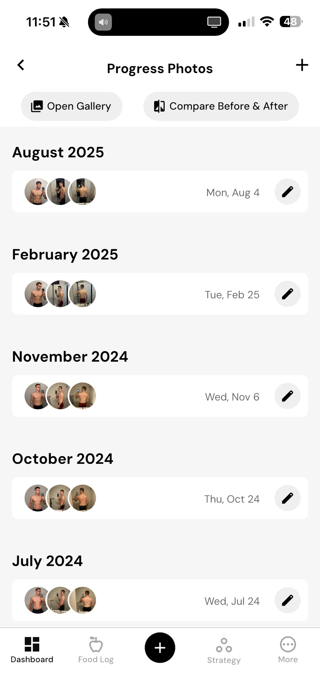
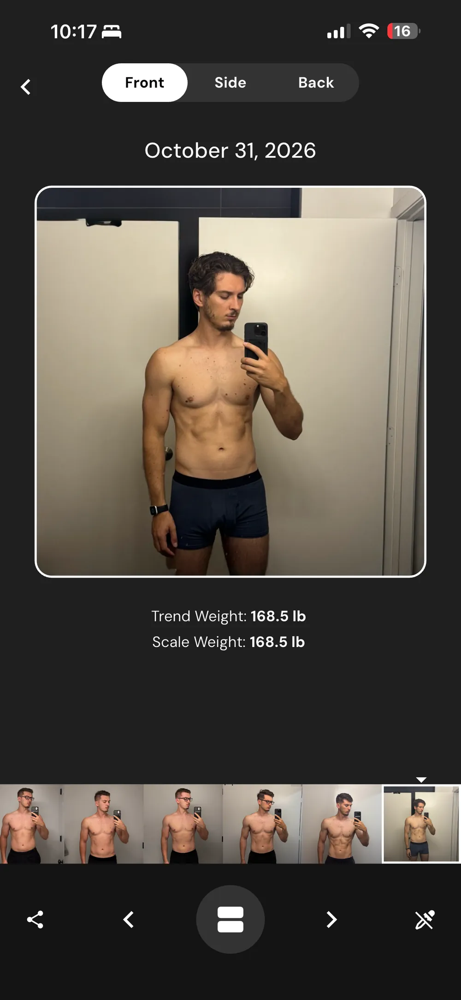
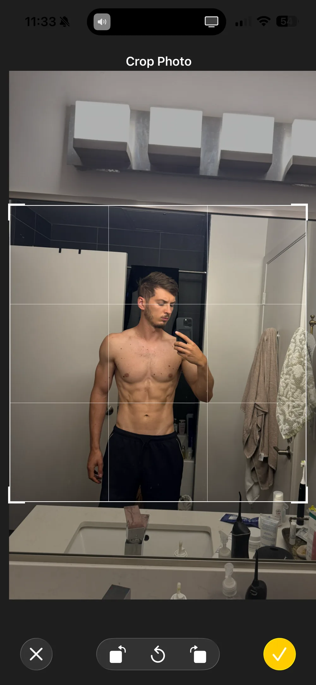
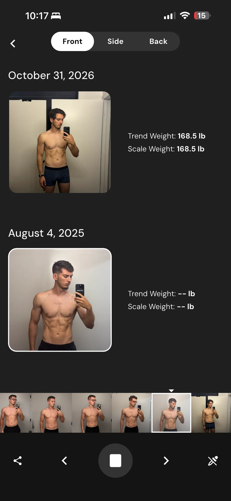
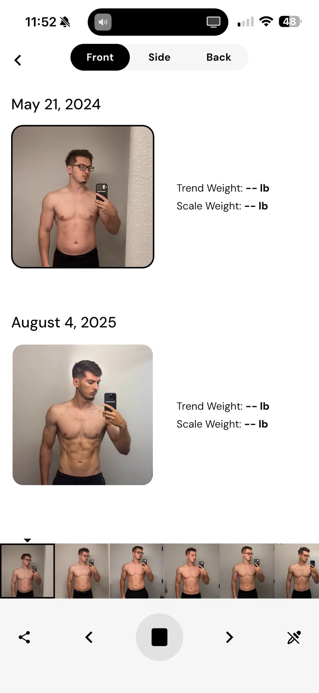
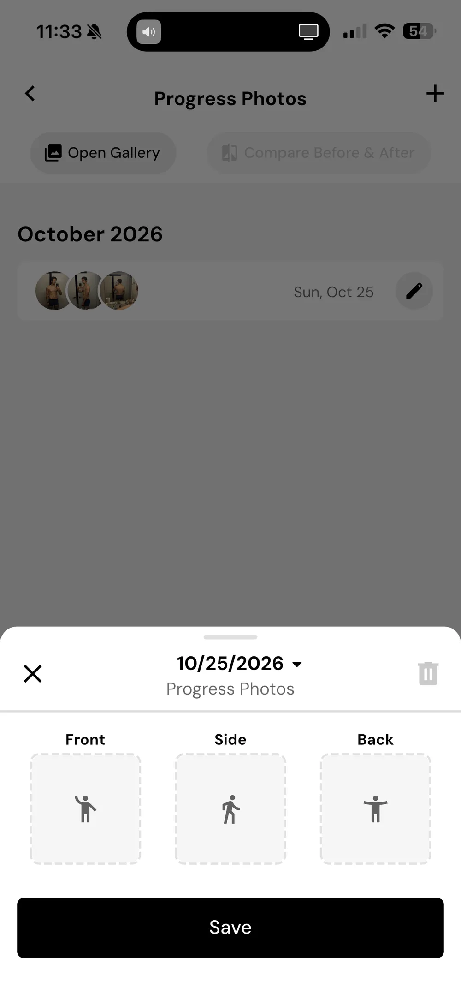
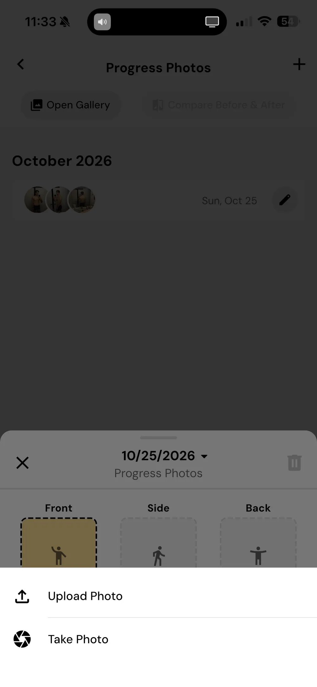

<!-- TODO(Mark): final title, seo_title and description once the verdict is written. Add card_blurb if the /blog/ card needs a shorter line. -->
<!-- TODO(Mark): set "published: YYYY-MM-DD" in the frontmatter and remove draft: true when this is ready. -->

## Quick Answer {#quick-answer}

<!-- TODO(Mark): two or three sentences: do I recommend MacroFactor for progress photos, and for whom. -->

**Full disclosure: I build Recomp, a free progress photo app, and I hold it to the same bar as every other app.** I don't run ads, and I don't use affiliate links.

MacroFactor is one of the 12 apps I've tested so far, and one of three fitness apps with a photo feature I tested alongside the dedicated progress photo apps. I tested it the way I test every app, with real photos and weights from my own transformation. [How I review progress photo apps](/blog/how-i-test-progress-photo-apps/) explains the method.

<!-- TODO(Mark): intro. What MacroFactor is for, what it costs, whether I paid for a subscription, and how many check-ins I added. Notes so far only say it's a fitness app with a photo feature. -->

## Is it a good photo album? {#photo-album}

<!-- TODO(Mark): are the photos the star? How much of the screen do they take, and do the buttons get in their way? How does it handle dozens or hundreds of photos? -->

The gallery keeps every photo in one place and switches between front, side and back from the same day. Each photo shows the body metrics you logged that day. The gallery tints its background and buttons to match the photo on screen. Source: [MacroFactor's body metrics announcement](https://macrofactor.com/body-metrics/).

{.phone}

Neither gallery view uses the screen well. The single view shows one square photo with empty space below it. The compare view stacks two small square photos with the weights beside them, so the photos take up a fraction of the screen.

{.phone}

## How does it handle alignment? {#alignment}

<!-- TODO(Mark): ease of alignment, gridline quality, ghost overlay, auto align, and whether I can align in the side by side view. -->

**You can only adjust a photo in the crop step, before you save it.** MacroFactor's help says you can zoom and rotate there. Once a photo is uploaded, I can't edit, resize or align it. Every photo is saved square. Take Photo launches the phone's camera, and I didn't find a ghost overlay, gridlines for posing or auto-align in MacroFactor's help. Source: [How to add progress photos](https://help.macrofactorapp.com/en/articles/121-how-to-add-progress-photos).

{.phone}

## How do comparisons and collages work? {#compare}

<!-- TODO(Mark): how easy it is to compare, and the taps and time to compare 9 different dates. Can it make a shareable before/after image or a timelapse? -->

Before and after stacks two photos of the same pose, one above the other. You tap the top slot and pick a photo from the ribbon of dates, then do the same for the bottom. The share image can use a plain background or one matched to the photo's colors. I didn't find a slider, overlay view or timelapse. Source: [How to create before-and-after photos](https://help.macrofactorapp.com/en/articles/123-how-to-create-and-share-before-and-after-photos).

{.phone}

{.phone}

## How does it handle my data? {#data}

<!-- TODO(Mark): adding a check-in: taps and seconds for a weight and front, side and back photos (great is under 30 seconds). Does it read the date from the photos, import weight from Apple Health, and let me pick all 3 photos in one picker? -->

Each date holds one front, one side and one back photo. They sit next to up to 21 body metrics, from waist and hips to waist-to-height ratio. Weight can come from Apple Health, and connecting it pulls in the last 30 days. You pick a date by hand for older photos. Sources: [How to add progress photos](https://help.macrofactorapp.com/en/articles/121-how-to-add-progress-photos), [body metrics announcement](https://macrofactor.com/body-metrics/), [Apple Health setup](https://help.macrofactorapp.com/en/articles/65-connect-health-connect-or-apple-health).

<!-- TODO(Mark): privacy: are photos ever sent to a third-party server? Account required? Backup and moving to a new phone, CSV weight import, photo export, Face ID or app lock, app switcher privacy. -->

Photos upload to MacroFactor's servers on Google Firebase. They stay there until you delete them or your account. You need an account to use the app, and the App Store privacy label lists photos as data linked to you. Data Export gives you spreadsheets of weight, nutrition and body metrics, and its help doesn't mention photos. [CONFIRM: photos aren't in the export.] Sources: [MacroFactor's personal data page](https://macrofactor.com/app-personal-data-protection-information/), [Export your data](https://help.macrofactorapp.com/en/articles/68-export-your-data), [App Store listing](https://apps.apple.com/us/app/id1553503471).

<!-- TODO(Mark): any quality-of-life items that matter for MacroFactor (bulk import, reminders, in-app camera, units, body measurements, editing a check-in's date, partial check-ins, dark mode, ads). Fold them into the sections above or below; no separate section or table unless it clearly helps. -->

**MacroFactor doesn't remind you to weigh in or take photos.** The only nudge is a small alert on the Strategy tab when your weekly check-in is due, and you pick the check-in day. That check-in updates calories and macros, not photos. Source: [MacroFactor's check-in help](https://help.macrofactorapp.com/en/articles/247-introduction-to-check-ins-and-coaching-modules).

MacroFactor has dark mode and switches between pounds and kilograms. I didn't find an app lock or Face ID option. Sources: [dark mode](https://help.macrofactorapp.com/en/articles/73-switch-between-dark-and-light-mode), [units](https://help.macrofactorapp.com/en/articles/353-changing-unit-preferences).

{.phone}

{.phone}

## What's good {#whats-good}

<!-- TODO(Mark): what's good. -->

## What's bad {#whats-bad}

<!-- TODO(Mark): what's bad. -->

## Who it's for {#who-its-for}

<!-- TODO(Mark): who I'd recommend it for. -->

## Verdict {#verdict}

<!-- TODO(Mark): qualitative verdict in plain words on whether I recommend it. No numeric score. -->

## When was this tested? {#when-tested}

- Published: <!-- TODO(Mark): publish date (also set "published:" in the frontmatter). -->
- Tested: October 2026

<!-- TODO(Mark): confirm the test month and app version. -->

There's no promise of when this page will be updated. If you think I got something wrong, email me at support@progressphotos.app.
