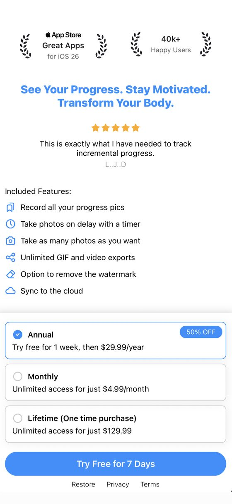
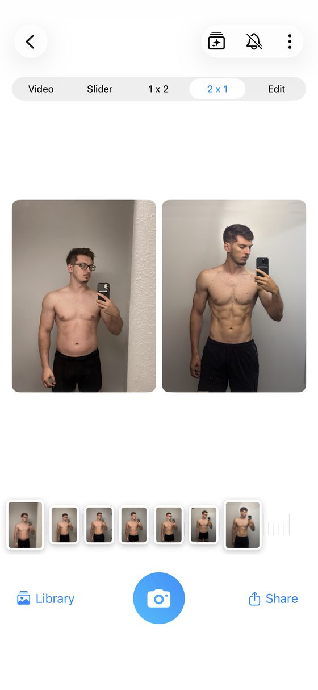
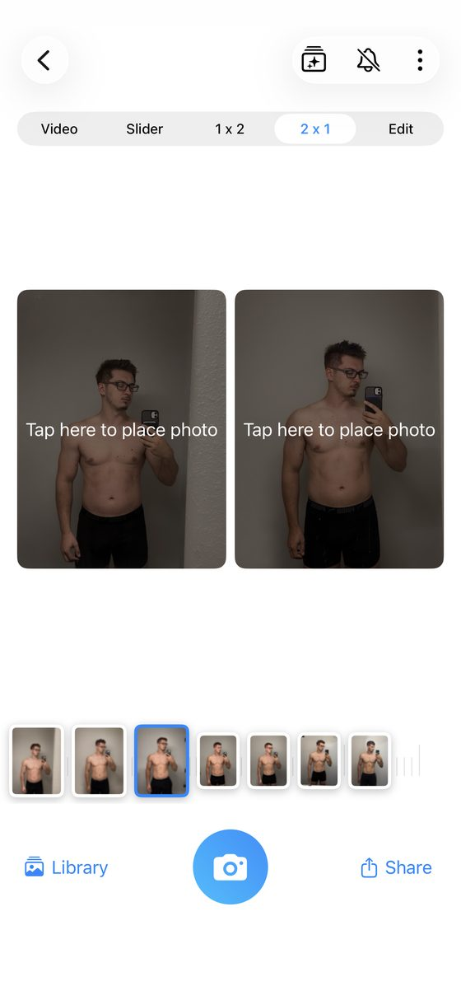
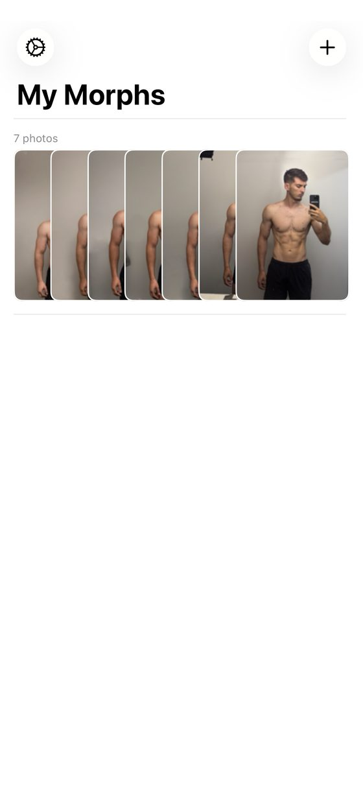

<!-- TODO(Mark): no "sameAs" on the author node yet. /about/ and the site link no X, Instagram, LinkedIn or GitHub profile for Mark. Add it here and on /about/ once one is public. -->

**Full disclosure: I build Recomp, a free progress photo app that competes with this one.** No app pays me <mark class="rounded-sm bg-yellow-200 px-1 text-black box-decoration-clone">\[CONFIRM: no ads, affiliate links or partner deals\]</mark>. This review expands the [Metamorph entry](/blog/best-progress-photo-apps/#metamorph) in my [roundup of the best progress photo apps](/blog/best-progress-photo-apps/), scored with [the same kit](/blog/how-i-test-progress-photo-apps/).

## What it costs {#what-it-costs}

**A free 7-day trial, then $29.99 a year, $4.99 a month or $129.99 lifetime.** The store also lists $4.99 a week. The trial arrived in 1.3 on Dec 12, 2024, and paying removes the watermark. <mark class="rounded-sm bg-yellow-200 px-1 text-black box-decoration-clone">\[TODO: what the free tier allows after the trial\]</mark>

{.phone}

## Taking a check-in {#taking-a-check-in}

**I proposed 3 out of 5 for capture.** It has a ghost overlay and a timer, but no weight logging. The timer arrived in 1.7 on Jan 23, 2025, and since 2.15 the overlay can be your first or your most recent photo. <mark class="rounded-sm bg-yellow-200 px-1 text-black box-decoration-clone">\[TODO: seconds and taps to a saved front, side and back check-in\]</mark>

## Lining photos up {#lining-photos-up}

**I proposed 0 for alignment: there's no alignment tool after the shot.** The ghost helps you line up before it. Its own site describes "the automatic alignment overlay to match your position, angle, and zoom to your previous photo before you shoot." An alignment grid arrived in 2.17 in Aug 2026. <mark class="rounded-sm bg-yellow-200 px-1 text-black box-decoration-clone">\[TODO: the rubric floor is 1; use 0 or 1?\]</mark>

## Comparing two dates {#comparing-two-dates}

**I proposed 2 for comparison.** It has a video time-lapse, a slider, 1x2 and 2x1, but the UI is poor, and you place each photo by hand. Picking a pair from hundreds of photos is slow in every app I tested, and this is the most manual version. <mark class="rounded-sm bg-yellow-200 px-1 text-black box-decoration-clone">\[TODO: seconds to put the oldest and newest front photos side by side\]</mark>

<figure class="m-0 min-w-0 flex-1"><figcaption class="mt-[0.65rem] text-center text-caption leading-[1.4] text-muted">2x1 compare, one of five tabs.</figcaption></figure><figure class="m-0 min-w-0 flex-1"><figcaption class="mt-[0.65rem] text-center text-caption leading-[1.4] text-muted">You place every photo by hand.</figcaption></figure>

## Importing old photos {#importing-old-photos}

**Metamorph imports existing photos from your library.** Its site doesn't say whether it reads each photo's date. <mark class="rounded-sm bg-yellow-200 px-1 text-black box-decoration-clone">\[TODO: import time, date handling and scroll test with the full library\]</mark>

## Where your photos live {#where-your-photos-live}

**Face ID locks the app, and photos stay on your device or iCloud, per its listing.** It doesn't explain whether iCloud means sync, a backup, or iCloud Photos as a source. Its paywall advertises cloud sync. <mark class="rounded-sm bg-yellow-200 px-1 text-black box-decoration-clone">\[TODO: delete-and-restore test\]</mark>

<mark class="rounded-sm bg-yellow-200 px-1 text-black box-decoration-clone">\[TODO: label vs policy conflict. The label says Data Not Collected, but the policy lists "Anonymous usage analytics such as screen views and button taps" and "Anonymous crash reports." Raise it; don't resolve it.\]</mark>

## Where Metamorph came from {#where-metamorph-came-from}

**Metamorph began as a stop-motion app for renovations, plants and kids before it turned to body progress.** Its own blog ranks Metamorph first. One 5-star review in my [review study](/blog/what-people-want-from-progress-photo-apps/) uses it for home renovations.

{.phone}

## Scores so far {#scores-so-far}

<table class="w-max min-w-full border-collapse text-left text-micro">
<thead>
<tr>
<th class="whitespace-nowrap border-b border-card-border px-3 py-2 align-bottom font-semibold text-fg" scope="col">Score (1 to 5)</th>
<th class="whitespace-nowrap border-b border-card-border px-3 py-2 align-bottom font-semibold text-fg" scope="col">Metamorph</th>
<th class="whitespace-nowrap border-b border-card-border px-3 py-2 align-bottom font-semibold text-fg" scope="col">Status</th>
</tr>
</thead>
<tbody>
<tr>
<th class="whitespace-nowrap border-b border-card-border px-3 py-2 align-top text-muted" scope="row">Capture and tracking</th>
<td class="border-b border-card-border px-3 py-2 align-top text-muted">3</td>
<td class="border-b border-card-border px-3 py-2 align-top text-muted">Proposed</td>
</tr>
<tr>
<th class="whitespace-nowrap border-b border-card-border px-3 py-2 align-top text-muted" scope="row">Alignment</th>
<td class="border-b border-card-border px-3 py-2 align-top text-muted">0</td>
<td class="border-b border-card-border px-3 py-2 align-top text-muted">Proposed; below the rubric floor of 1</td>
</tr>
<tr>
<th class="whitespace-nowrap border-b border-card-border px-3 py-2 align-top text-muted" scope="row">Comparison</th>
<td class="border-b border-card-border px-3 py-2 align-top text-muted">2</td>
<td class="border-b border-card-border px-3 py-2 align-top text-muted">Proposed</td>
</tr>
<tr>
<th class="whitespace-nowrap border-b border-card-border px-3 py-2 align-top text-muted" scope="row">Design</th>
<td class="border-b border-card-border px-3 py-2 align-top text-muted">TBD</td>
<td class="border-b border-card-border px-3 py-2 align-top text-muted"></td>
</tr>
<tr>
<th class="whitespace-nowrap border-b border-card-border px-3 py-2 align-top text-muted" scope="row">Performance</th>
<td class="border-b border-card-border px-3 py-2 align-top text-muted">TBD</td>
<td class="border-b border-card-border px-3 py-2 align-top text-muted"></td>
</tr>
<tr>
<th class="whitespace-nowrap border-b border-card-border px-3 py-2 align-top text-muted" scope="row">Privacy</th>
<td class="border-b border-card-border px-3 py-2 align-top text-muted">TBD</td>
<td class="border-b border-card-border px-3 py-2 align-top text-muted"></td>
</tr>
<tr>
<th class="whitespace-nowrap border-b border-card-border px-3 py-2 align-top text-muted" scope="row">Backup</th>
<td class="border-b border-card-border px-3 py-2 align-top text-muted">TBD</td>
<td class="border-b border-card-border px-3 py-2 align-top text-muted"></td>
</tr>
<tr>
<th class="whitespace-nowrap border-b border-card-border px-3 py-2 align-top text-muted" scope="row">Import (bonus, outside the total)</th>
<td class="border-b border-card-border px-3 py-2 align-top text-muted">TBD</td>
<td class="border-b border-card-border px-3 py-2 align-top text-muted"></td>
</tr>
<tr>
<th class="whitespace-nowrap border-b border-card-border px-3 py-2 align-top text-muted" scope="row">Total out of 35</th>
<td class="border-b border-card-border px-3 py-2 align-top text-muted">TBD</td>
<td class="border-b border-card-border px-3 py-2 align-top text-muted">5 from the three proposed</td>
</tr>
</tbody>
</table>

<mark class="rounded-sm bg-yellow-200 px-1 text-black box-decoration-clone">\[CONFIRM: rescore on the v8 rubric or the Oct 4 measured tiers; v7 provisional grade was B, 17/25.\]</mark>

## The numbers {#the-numbers}

**Every app's numbers sit side by side, with test dates, in [my test data](/blog/how-i-test-progress-photo-apps/#store-data).**

<table class="w-max min-w-full border-collapse text-left text-micro">
<thead>
<tr>
<th class="whitespace-nowrap border-b border-card-border px-3 py-2 align-bottom font-semibold text-fg" scope="col">Field</th>
<th class="whitespace-nowrap border-b border-card-border px-3 py-2 align-bottom font-semibold text-fg" scope="col">Value</th>
</tr>
</thead>
<tbody>
<tr>
<th class="whitespace-nowrap border-b border-card-border px-3 py-2 align-top text-muted" scope="row">Full name</th>
<td class="border-b border-card-border px-3 py-2 align-top text-muted">Body Progress Pics: Metamorph</td>
</tr>
<tr>
<th class="whitespace-nowrap border-b border-card-border px-3 py-2 align-top text-muted" scope="row">Rating</th>
<td class="border-b border-card-border px-3 py-2 align-top text-muted">4.38 from 68 US ratings (Oct 3, 2026)</td>
</tr>
<tr>
<th class="whitespace-nowrap border-b border-card-border px-3 py-2 align-top text-muted" scope="row">Written reviews, Jul 2 to Oct 2, 2026</th>
<td class="border-b border-card-border px-3 py-2 align-top text-muted">1 (US feed)</td>
</tr>
<tr>
<th class="whitespace-nowrap border-b border-card-border px-3 py-2 align-top text-muted" scope="row">Written reviews in Apple's feed</th>
<td class="border-b border-card-border px-3 py-2 align-top text-muted">32 in my study</td>
</tr>
<tr>
<th class="whitespace-nowrap border-b border-card-border px-3 py-2 align-top text-muted" scope="row">First released</th>
<td class="border-b border-card-border px-3 py-2 align-top text-muted">Oct 10, 2024</td>
</tr>
<tr>
<th class="whitespace-nowrap border-b border-card-border px-3 py-2 align-top text-muted" scope="row">Last updated</th>
<td class="border-b border-card-border px-3 py-2 align-top text-muted">Aug 6, 2026</td>
</tr>
<tr>
<th class="whitespace-nowrap border-b border-card-border px-3 py-2 align-top text-muted" scope="row">Version tested</th>
<td class="border-b border-card-border px-3 py-2 align-top text-muted">2.17 <mark class="rounded-sm bg-yellow-200 px-1 text-black box-decoration-clone">[CONFIRM]</mark></td>
</tr>
<tr>
<th class="whitespace-nowrap border-b border-card-border px-3 py-2 align-top text-muted" scope="row">Requires</th>
<td class="border-b border-card-border px-3 py-2 align-top text-muted">iOS 18.0+ on iPhone, plus Apple Silicon Mac and Vision Pro; no iPad or Android</td>
</tr>
<tr>
<th class="whitespace-nowrap border-b border-card-border px-3 py-2 align-top text-muted" scope="row">App Store</th>
<td class="border-b border-card-border px-3 py-2 align-top text-muted"><a href="https://apps.apple.com/us/app/body-progress-pics-metamorph/id6544789120">Body Progress Pics: Metamorph on the App Store</a></td>
</tr>
</tbody>
</table>

## What to use instead {#what-to-use-instead}

**For a ghost overlay at capture and a better compare screen, see my [Then &amp; Now review](/blog/then-and-now-review/).** For auto-align, see [Thumbstone](/blog/thumbstone-review/). For a one-time price far below $129.99, see [Fit-Stitch](/blog/fit-stitch-review/) at $4.99.

## What I haven't tested yet {#what-i-havent-tested-yet}

**I still need design, performance, privacy, backup and import scores, and what "iCloud" means in practice.** If you've used Metamorph's cloud sync, email me at [support@progressphotos.app](mailto:support@progressphotos.app).

<!-- chrome:author-bio depth="2" -->
<aside
class="mt-12 flex flex-wrap items-center gap-4 rounded-card border border-card-border bg-card px-[1.4rem] py-[1.35rem] sm:flex-nowrap sm:items-start"
aria-labelledby="author-bio-heading"
>
<!-- TODO(Mark): pick a photo. Replace this div with . The 64×64 box is reserved so nothing shifts. -->

<mark class="rounded-sm bg-yellow-200 px-1 text-black box-decoration-clone">TODO photo</mark>

<h2 id="author-bio-heading" class="min-w-0 flex-1 text-h4 font-bold tracking-h4">About the author</h2>

<strong class="text-fg">I'm Mark Stepchin, and I make Recomp, so read what I say about other apps with that in mind.</strong>
I'm a software engineer who has worked at Silicon Valley startups, with some time at Apple.
I've trained for years: I bulked from 145 to 195 lb, cut to 155, and now sit around 165.
Before building Recomp in my evenings and weekends from San Diego, I tried more than 10 progress photo apps.
<a href="../../about/">More about me</a>

<!-- TODO(Mark): the weight history comes from your Oct 17 brief and isn't on /about/ yet. Confirm the numbers before publishing. -->
<!-- TODO(Mark): "tried more than 10" is the public claim from /blog/why-i-built-recomp/. Don't say "tested 36 apps": 36 is the proposed candidate list in the how-i-test draft, with no screening log yet, and hands-on scoring is partial (6 of 10 apps have proposed scores). Once testing is done, this could read "I screened 36 apps and tested N hands-on." -->

</aside>
<!-- /chrome:author-bio -->
