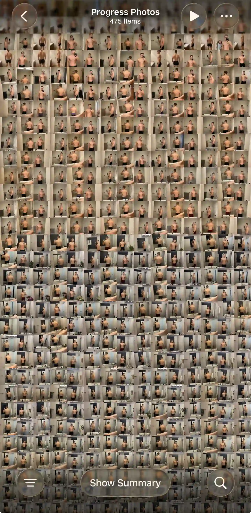
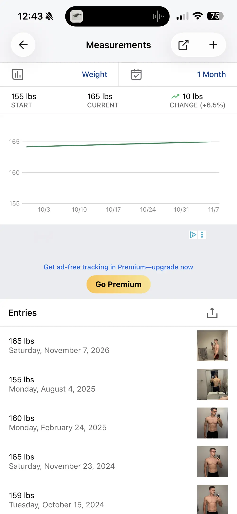
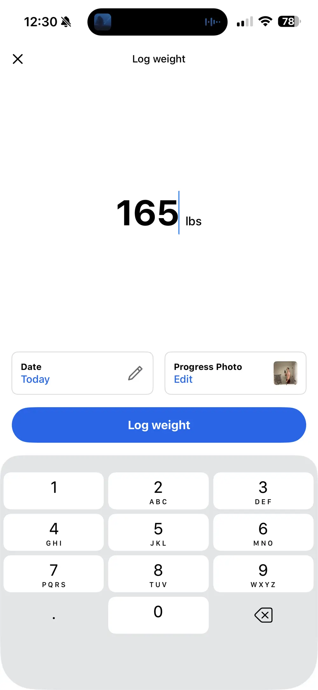
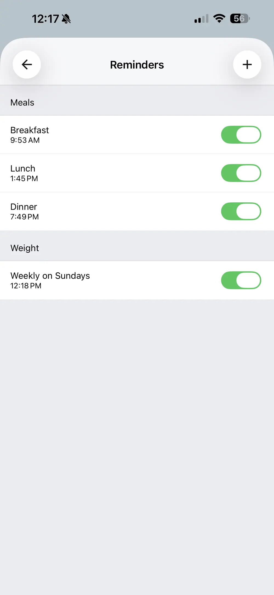
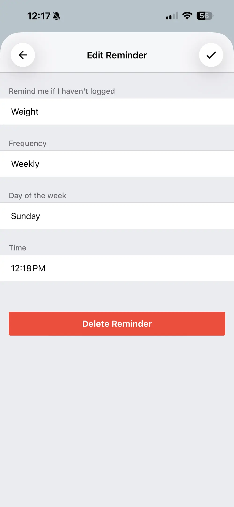
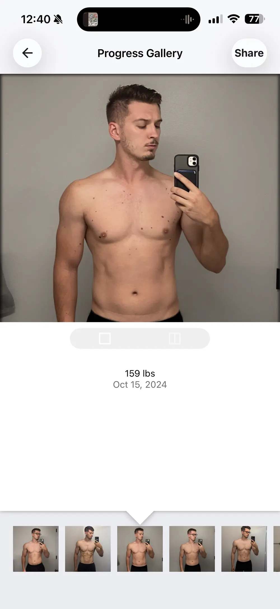
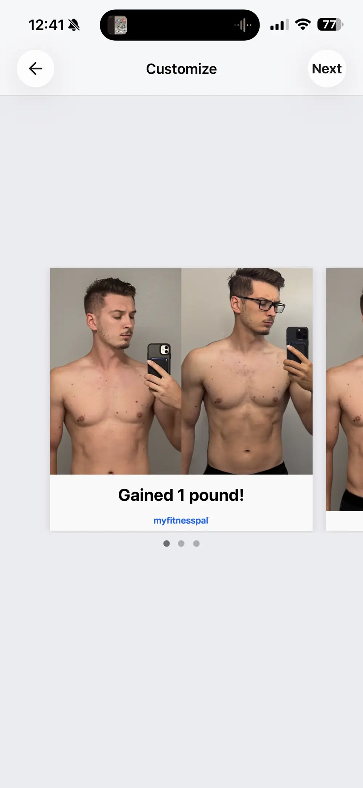

<!-- app-store-card -->

## Built for calories, not photos {#design-tradeoffs}

If you’re one of the many people who already use MyFitnessPal, you’re probably wondering if you really need to download and set up a whole new app. And yes, while MyFitnessPal does have progress photo tracking, it makes multiple tradeoffs to optimize for calories over photo tracking.

Apple’s native apps are a perfect case study for why it makes sense to separate apps that can seem closely related.

- Camera and Photos
- Health and Fitness
- Notes and Numbers

Separating these apps provides a better user experience for each individual use case. We recommend using multiple apps and tools, each designed for a specific use case. At the very least, you need a workout tracker, a calorie tracker, and a progress photo tracker.

## How I test {#how-i-test}

After personally tracking hundreds of progress photos over several years, I have an opinionated philosophy on what's a must-have, what's nice-to-have, and what's fluff. A great progress photo tracker is four apps in one:

1. Photos app / camera roll
2. Great alignment tools for consistent comparisons
3. Collage app with multiple ways to compare your photos over time
4. Weight, measurements, and notes all associated with photos

I test each of these features with my personal library of real progress photos and weight records. See [How I review progress photo apps](/blog/how-i-test-progress-photo-apps/) to learn more.

{.phone}

## Adding progress data {#adding-data}

### Weight reminders {#reminders}

**MyFitnessPal lets you set a reminder to log your weight. You can attach one progress photo to each weigh-in.** Sources: [logging reminders](https://support.myfitnesspal.com/hc/en-us/articles/360032622391-How-to-set-up-logging-reminders), [how often to weigh in](https://support.myfitnesspal.com/hc/en-us/articles/360032272992-How-often-should-I-record-my-weight-and-other-measurements).

### Photos {#adding-photos}

**MyFitnessPal is built around tracking weight, and photos are an add-on.** You add a weight record under More > Weight & Measurements and can attach a photo to it. Photos taken in the app aren't saved to your camera roll. The in-app camera has no zoom. [MyFitnessPal's progress photos FAQ](https://support.myfitnesspal.com/hc/en-us/articles/360032625271-Progress-Photos-FAQs).

**Since photos attach to weigh-ins, MyFitnessPal keeps only one photo per date.** This makes it impossible to track multiple angles, such as front, side and back photos on the same day.

### Weights and measurements {#weights}

Weight syncs both ways with Apple Health, but only from the day you connect. Older Health weigh-ins don't come over. Waist, hips, neck and weight are built in. Anything else, like body fat or thighs, has to be added on the website first, with one value per measurement per day. Sources: [Apple Health syncing](https://support.myfitnesspal.com/hc/en-us/articles/360032271092-Apple-Health-connection-and-syncing), [additional measurements](https://support.myfitnesspal.com/hc/en-us/articles/360032624891-Can-I-track-additional-measurements-or-change-the-default-measurements).

{.phone}

{.phone}

{.phone}

{.phone}

{.phone}

## Alignment {#alignment}

**MyFitnessPal has no alignment options.** There's no overlay, gridlines or auto-align, and no way to adjust a photo after you add it.

MyFitnessPal supports **square aspect ratio only** and crops every photo square when you upload it. [progress photos FAQ](https://support.myfitnesspal.com/hc/en-us/articles/360032625271-Progress-Photos-FAQs).

## Comparison Features {#compare}

MyFitnessPal has both single and side-by-side views for comparison, with a thumbnail strip along the bottom for easy switching. It lacks a full-screen view for a single photo like in the Photos app. It doesn't have a slider view, overlay, or timelapse. <!-- TODO(feature-link): link "slider" to Recomp's Slider view feature page once it exists --> <!-- TODO(feature-link): link "overlay view" to Recomp's Overlay view feature page once it exists --> <!-- TODO(feature-link): link "timelapse" to Recomp's Timelapse feature page once it exists -->

You can zoom and pan in the small viewer, but those adjustments aren't saved.

You can share a single photo or side-by-side view, along with a message, directly to Instagram or Facebook. [progress photos FAQ](https://support.myfitnesspal.com/hc/en-us/articles/360032625271-Progress-Photos-FAQs).

{.phone}

{.phone}

{.phone}

## Quality of life and privacy {#sharing}

Photos are saved to your MyFitnessPal account on its servers, which is how they show up on a new phone. You need an account. The App Store privacy label lists identifiers and usage data used to track you across other companies' apps, plus data for third-party advertising. Data Export requires Premium. It emails a zip of three CSVs, including weight and measurements, and no photos. Sources: [progress photos FAQ](https://support.myfitnesspal.com/hc/en-us/articles/360032625271-Progress-Photos-FAQs), [data export](https://support.myfitnesspal.com/hc/en-us/articles/360032273352-Export-your-nutrition-progress-and-exercise-data), [App Store listing](https://apps.apple.com/us/app/id341232718).

MyFitnessPal has ads. Ad-free tracking needs Premium.

<!-- scorecard -->
