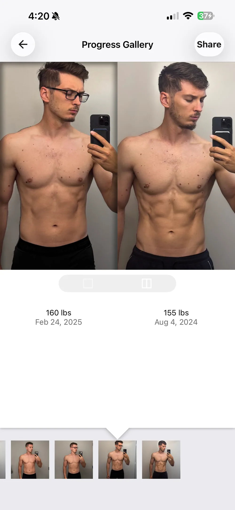
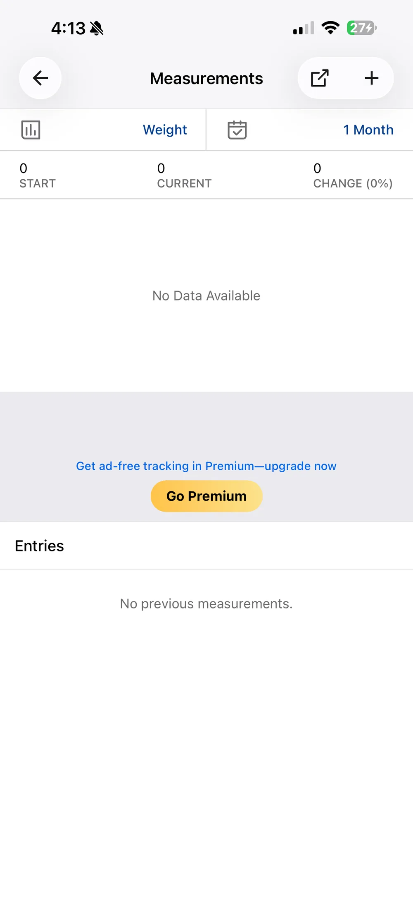
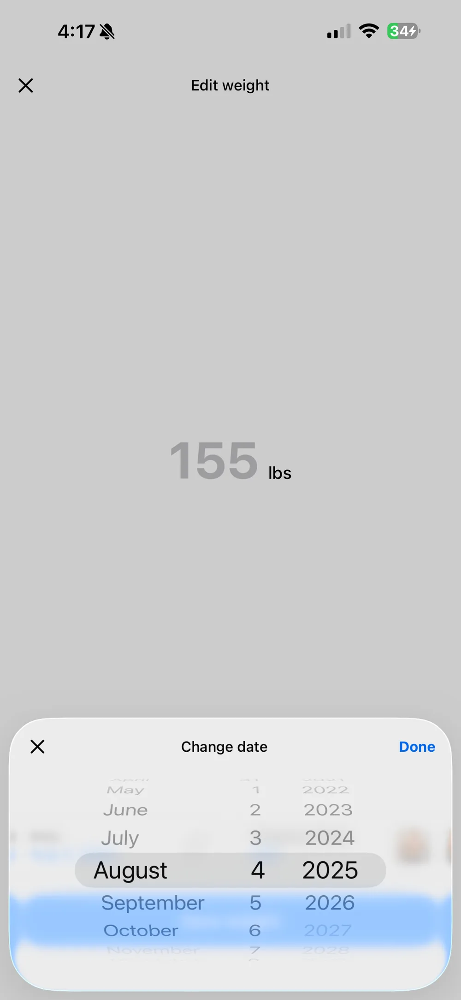

<!-- TODO(Mark): final title, seo_title and description once the verdict is written. Add card_blurb if the /blog/ card needs a shorter line. -->
<!-- TODO(Mark): set "published: YYYY-MM-DD" in the frontmatter and remove draft: true when this is ready. -->

**Full disclosure: I build Recomp, a free progress photo app.**

<!-- app-store-card -->

MyFitnessPal is one of the 12 apps I've tested so far, and one of three fitness apps with a photo feature I tested alongside the dedicated progress photo apps. I tested it the way I test every app, with real photos and weights from my own transformation. [How I review progress photo apps](/blog/how-i-test-progress-photo-apps/) explains the method.

<!-- TODO(Mark): intro. What MyFitnessPal is for, what it costs, whether I paid for a subscription, and how many check-ins I added. Notes so far only say it's a fitness app with a photo feature. -->

## Is it a good photo album? {#photo-album}

<!-- TODO(Mark): are the photos the star? How much of the screen do they take, and do the buttons get in their way? How does it handle dozens or hundreds of photos? -->

**MyFitnessPal is built around tracking weight, and photos are an add-on.** You add a weight record under More > Weight & Measurements and can attach a photo to it. Photos taken in the app aren't saved to your camera roll. Source: [MyFitnessPal's progress photos FAQ](https://support.myfitnesspal.com/hc/en-us/articles/360032625271-Progress-Photos-FAQs).

## How does it handle alignment? {#alignment}

<!-- TODO(Mark): ease of alignment, gridline quality, ghost overlay, auto align, and whether I can align in the side by side view. -->

**MyFitnessPal has no alignment tools.** There's no overlay, gridlines or auto-align, and no way to adjust a photo after you add it. It crops every photo square when you upload it, so anything outside the center gets cut. Source: [progress photos FAQ](https://support.myfitnesspal.com/hc/en-us/articles/360032625271-Progress-Photos-FAQs).

## How do comparisons and collages work? {#compare}

<!-- TODO(Mark): how easy it is to compare, and the taps and time to compare 9 different dates. Can it make a shareable before/after image or a timelapse? -->

Sharing works from any photo in the Entries list. You can swipe between photos, add a message and save a split photo or send it to Instagram or Facebook. I didn't find a slider, overlay view or timelapse. Source: [progress photos FAQ](https://support.myfitnesspal.com/hc/en-us/articles/360032625271-Progress-Photos-FAQs).

{.phone}

## How does it handle my data? {#data}

<!-- TODO(Mark): adding a check-in: taps and seconds for a weight and front, side and back photos (great is under 30 seconds). Does it read the date from the photos, import weight from Apple Health, and let me pick all 3 photos in one picker? -->

**Since photos attach to weigh-ins, MyFitnessPal keeps only one photo per date.** I can't keep a front, side and back photo for the same day.

Weight syncs both ways with Apple Health, but only from the day you connect. Older Health weigh-ins don't come over. Waist, hips, neck and weight are built in. Anything else, like body fat or thighs, has to be added on the website first, with one value per measurement per day. Sources: [Apple Health syncing](https://support.myfitnesspal.com/hc/en-us/articles/360032271092-Apple-Health-connection-and-syncing), [additional measurements](https://support.myfitnesspal.com/hc/en-us/articles/360032624891-Can-I-track-additional-measurements-or-change-the-default-measurements).

<!-- TODO(Mark): privacy: are photos ever sent to a third-party server? Account required? Backup and moving to a new phone, CSV weight import, photo export, Face ID or app lock, app switcher privacy. -->

Photos are saved to your MyFitnessPal account on its servers, which is how they show up on a new phone. You need an account. The App Store privacy label lists identifiers and usage data used to track you across other companies' apps, plus data for third-party advertising. Data Export is Premium only. It emails a zip of three CSVs, including weight and measurements, and no photos. Sources: [progress photos FAQ](https://support.myfitnesspal.com/hc/en-us/articles/360032625271-Progress-Photos-FAQs), [data export](https://support.myfitnesspal.com/hc/en-us/articles/360032273352-Export-your-nutrition-progress-and-exercise-data), [App Store listing](https://apps.apple.com/us/app/id341232718).

<!-- TODO(Mark): any quality-of-life items that matter for MyFitnessPal (bulk import, reminders, in-app camera, units, body measurements, editing a check-in's date, partial check-ins, dark mode, ads). Fold them into the sections above or below; no separate section or table unless it clearly helps. -->

**MyFitnessPal's reminders are for meals, not photos or weigh-ins.** Each one fires if you haven't logged a chosen meal by a set time. Its help recommends weighing in once a week, but I didn't find a reminder for it. [CONFIRM: in Profile > Reminders > +, is there a weigh-in option?] Sources: [logging reminders](https://support.myfitnesspal.com/hc/en-us/articles/360032622391-How-to-set-up-logging-reminders), [how often to weigh in](https://support.myfitnesspal.com/hc/en-us/articles/360032272992-How-often-should-I-record-my-weight-and-other-measurements).

{.phone}

{.phone}

## What's good {#whats-good}

<!-- TODO(Mark): what's good. -->

## What's bad {#whats-bad}

<!-- TODO(Mark): what's bad. -->

## Who it's for {#who-its-for}

<!-- TODO(Mark): who I'd recommend it for. -->

## Verdict {#verdict}

<!-- TODO(Mark): qualitative verdict in plain words on whether I recommend it. No numeric score. -->

## FAQ {#faq}

<!-- TODO(Mark): questions readers ask about MyFitnessPal's progress photos, each as a ### question with its answer. Add every one to the faq frontmatter too, word for word. -->

<!-- scorecard -->

---

Published: [CONFIRM: publish date]

Tested: October 2026 {#when-tested}

<!-- TODO(Mark): confirm the test month and app version. -->

Questions or corrections: support@progressphotos.app
