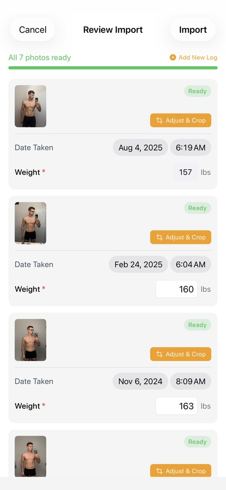
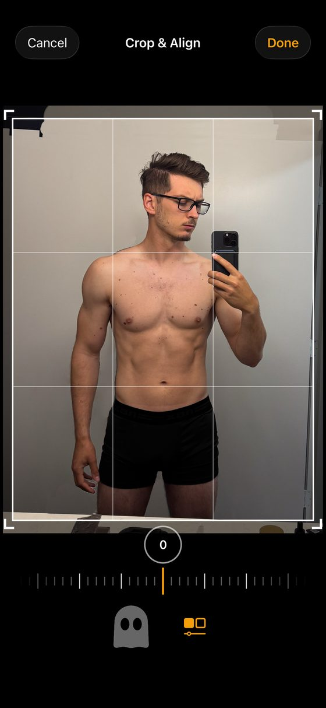
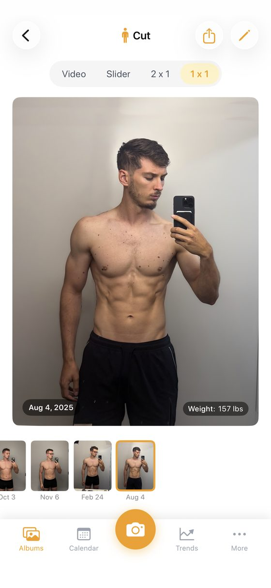
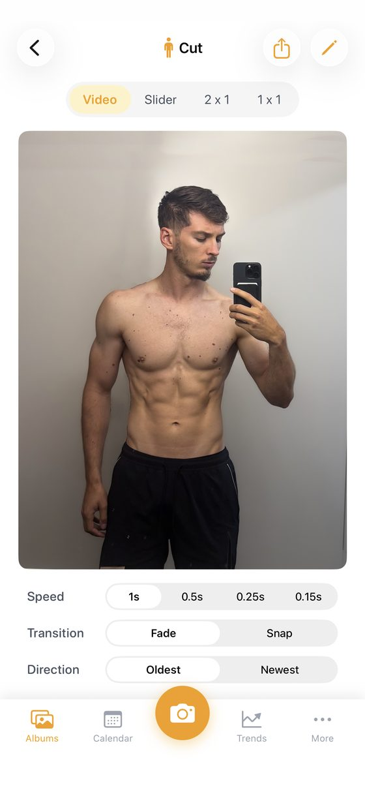
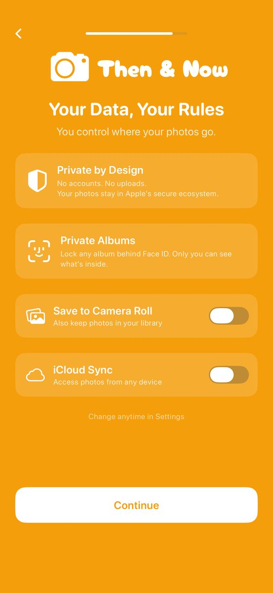
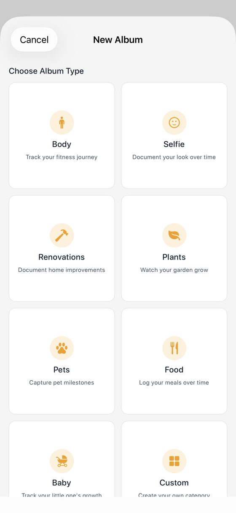

<!-- TODO(Mark): no "sameAs" on the author node yet. /about/ and the site link no X, Instagram, LinkedIn or GitHub profile for Mark. Add it here and on /about/ once one is public. -->

**Full disclosure: I build Recomp, a free progress photo app that competes with this one.** No app pays me <mark class="rounded-sm bg-yellow-200 px-1 text-black box-decoration-clone">\[CONFIRM: no ads, affiliate links or partner deals\]</mark>. This review expands the [Then &amp; Now entry](/blog/best-progress-photo-apps/#then-and-now) in my [roundup of the best progress photo apps](/blog/best-progress-photo-apps/), scored with [the same kit](/blog/how-i-test-progress-photo-apps/).

<mark class="rounded-sm bg-yellow-200 px-1 text-black box-decoration-clone">\[TODO: placement. The roundup picks Then &amp; Now for hands-free capture, but the voice timer behind that pick is Premium, and the entry also calls it one of the better apps for compare. Decide which pick it gets, and whether "Beginner all-in-one" fits.\]</mark>

## What it costs {#what-it-costs}

**Then &amp; Now is free, with Premium at $4.99 a month, $29.99 a year or $99.99 lifetime.** The annual plan has a one-week free trial. Free users can store a limited number of photos per week, and free exports carry a watermark. Premium unlocks the ghost overlay, the voice timer, every compare mode including the time-lapse, album locking and advanced metrics, per its support FAQ.

## Taking a check-in {#taking-a-check-in}

**I proposed 4 out of 5 for capture.** It has a voice timer, body silhouettes and a ghost overlay, and the timer and overlay are Premium. Speech recognition runs on the device, per its policy. <mark class="rounded-sm bg-yellow-200 px-1 text-black box-decoration-clone">\[CONFIRM: the only voice timer of the 10 apps, after testing\]</mark> <mark class="rounded-sm bg-yellow-200 px-1 text-black box-decoration-clone">\[TODO: seconds and taps to a saved check-in\]</mark>

## Importing old photos {#importing-old-photos}

**Its import process is very nice.** Bulk import reads each photo's date taken, and asks for a weight for every photo. Bulk import arrived in 1.2 on Mar 3, 2026, and a redesigned review flow in 2.0 on Apr 4. Imported photos keep their original EXIF data, including location, per its policy. <mark class="rounded-sm bg-yellow-200 px-1 text-black box-decoration-clone">\[TODO: whether same-day photos group into one check-in\]</mark> <mark class="rounded-sm bg-yellow-200 px-1 text-black box-decoration-clone">\[TODO: the roundup says both Recomp and Then &amp; Now read photo dates; the policy only says EXIF is kept. Confirm which sets the entry date.\]</mark>

{.phone}

## Lining photos up {#lining-photos-up}

**I proposed 2 for alignment.** Manual Crop &amp; Align has pan, zoom and rotate, a straighten dial and a ghost toggle. It was redesigned in 2.3 on Jul 4, 2026. It works, but you reach it one photo at a time inside Adjust &amp; Crop, so it's not convenient.

{.phone}

## Comparing two dates {#comparing-two-dates}

**I proposed 3 for comparison.** It has a video time-lapse, a slider, 2x1 and 1x1, with the date and weight on each photo. Since 2.2, Apple Health values show in Side by Side. It's a standard UI that works but isn't amazing.

<figure class="m-0 min-w-0 flex-1"><figcaption class="mt-[0.65rem] text-center text-caption leading-[1.4] text-muted">1x1 compare with date and weight.</figcaption></figure><figure class="m-0 min-w-0 flex-1"><figcaption class="mt-[0.65rem] text-center text-caption leading-[1.4] text-muted">Video mode: speed, fade or snap, and direction.</figcaption></figure>

## Where your photos live {#where-your-photos-live}

**Then &amp; Now's label reads Data Not Collected, the runner-up to Check-In on privacy in my roundup.** Its policy says no analytics, advertising identifiers or third-party tracking SDKs, and it needs no account. Data lives on the device. Face ID locks each album.

**iCloud sync and Save to Camera Roll are optional and off by default.** Sync uses CloudKit across devices on the same iCloud account. The developer's FAQ says deleting the app removes all local data. <mark class="rounded-sm bg-yellow-200 px-1 text-black box-decoration-clone">\[TODO: does a CloudKit restore work on a fresh install?\]</mark>

{.phone}

## Not only for fitness {#not-only-for-fitness}

**Album types like Renovations, Plants and Pets make it a general-purpose before/after app.** It syncs weight and body measurements with Apple Health since 2.0. I found no Android version.

{.phone}

## Scores so far {#scores-so-far}

<table class="w-max min-w-full border-collapse text-left text-micro">
<thead>
<tr>
<th class="whitespace-nowrap border-b border-card-border px-3 py-2 align-bottom font-semibold text-fg" scope="col">Score (1 to 5)</th>
<th class="whitespace-nowrap border-b border-card-border px-3 py-2 align-bottom font-semibold text-fg" scope="col">Then &amp; Now</th>
<th class="whitespace-nowrap border-b border-card-border px-3 py-2 align-bottom font-semibold text-fg" scope="col">Status</th>
</tr>
</thead>
<tbody>
<tr>
<th class="whitespace-nowrap border-b border-card-border px-3 py-2 align-top text-muted" scope="row">Capture and tracking</th>
<td class="border-b border-card-border px-3 py-2 align-top text-muted">4</td>
<td class="border-b border-card-border px-3 py-2 align-top text-muted">Proposed</td>
</tr>
<tr>
<th class="whitespace-nowrap border-b border-card-border px-3 py-2 align-top text-muted" scope="row">Alignment</th>
<td class="border-b border-card-border px-3 py-2 align-top text-muted">2</td>
<td class="border-b border-card-border px-3 py-2 align-top text-muted">Proposed</td>
</tr>
<tr>
<th class="whitespace-nowrap border-b border-card-border px-3 py-2 align-top text-muted" scope="row">Comparison</th>
<td class="border-b border-card-border px-3 py-2 align-top text-muted">3</td>
<td class="border-b border-card-border px-3 py-2 align-top text-muted">Proposed</td>
</tr>
<tr>
<th class="whitespace-nowrap border-b border-card-border px-3 py-2 align-top text-muted" scope="row">Design</th>
<td class="border-b border-card-border px-3 py-2 align-top text-muted">TBD</td>
<td class="border-b border-card-border px-3 py-2 align-top text-muted"></td>
</tr>
<tr>
<th class="whitespace-nowrap border-b border-card-border px-3 py-2 align-top text-muted" scope="row">Performance</th>
<td class="border-b border-card-border px-3 py-2 align-top text-muted">TBD</td>
<td class="border-b border-card-border px-3 py-2 align-top text-muted"></td>
</tr>
<tr>
<th class="whitespace-nowrap border-b border-card-border px-3 py-2 align-top text-muted" scope="row">Privacy</th>
<td class="border-b border-card-border px-3 py-2 align-top text-muted">TBD</td>
<td class="border-b border-card-border px-3 py-2 align-top text-muted"></td>
</tr>
<tr>
<th class="whitespace-nowrap border-b border-card-border px-3 py-2 align-top text-muted" scope="row">Backup</th>
<td class="border-b border-card-border px-3 py-2 align-top text-muted">TBD</td>
<td class="border-b border-card-border px-3 py-2 align-top text-muted"></td>
</tr>
<tr>
<th class="whitespace-nowrap border-b border-card-border px-3 py-2 align-top text-muted" scope="row">Import (bonus, outside the total)</th>
<td class="border-b border-card-border px-3 py-2 align-top text-muted">TBD</td>
<td class="border-b border-card-border px-3 py-2 align-top text-muted"></td>
</tr>
<tr>
<th class="whitespace-nowrap border-b border-card-border px-3 py-2 align-top text-muted" scope="row">Total out of 35</th>
<td class="border-b border-card-border px-3 py-2 align-top text-muted">TBD</td>
<td class="border-b border-card-border px-3 py-2 align-top text-muted">9 from the three proposed</td>
</tr>
</tbody>
</table>

<mark class="rounded-sm bg-yellow-200 px-1 text-black box-decoration-clone">\[CONFIRM: rescore on the v8 rubric or the Oct 4 measured tiers; v7 provisional grade was A, 20/25.\]</mark>

## The numbers {#the-numbers}

**Every app's numbers sit side by side, with test dates, in [my test data](/blog/how-i-test-progress-photo-apps/#store-data).**

<table class="w-max min-w-full border-collapse text-left text-micro">
<thead>
<tr>
<th class="whitespace-nowrap border-b border-card-border px-3 py-2 align-bottom font-semibold text-fg" scope="col">Field</th>
<th class="whitespace-nowrap border-b border-card-border px-3 py-2 align-bottom font-semibold text-fg" scope="col">Value</th>
</tr>
</thead>
<tbody>
<tr>
<th class="whitespace-nowrap border-b border-card-border px-3 py-2 align-top text-muted" scope="row">Full name</th>
<td class="border-b border-card-border px-3 py-2 align-top text-muted">Progress Pics Photo Then &amp; Now</td>
</tr>
<tr>
<th class="whitespace-nowrap border-b border-card-border px-3 py-2 align-top text-muted" scope="row">Rating</th>
<td class="border-b border-card-border px-3 py-2 align-top text-muted">5.0 from 9 US ratings (Oct 3, 2026)</td>
</tr>
<tr>
<th class="whitespace-nowrap border-b border-card-border px-3 py-2 align-top text-muted" scope="row">Written reviews, Jul 2 to Oct 2, 2026</th>
<td class="border-b border-card-border px-3 py-2 align-top text-muted">0 (US feed)</td>
</tr>
<tr>
<th class="whitespace-nowrap border-b border-card-border px-3 py-2 align-top text-muted" scope="row">Written reviews in Apple's feed</th>
<td class="border-b border-card-border px-3 py-2 align-top text-muted">4 in my study</td>
</tr>
<tr>
<th class="whitespace-nowrap border-b border-card-border px-3 py-2 align-top text-muted" scope="row">First released</th>
<td class="border-b border-card-border px-3 py-2 align-top text-muted">Feb 26, 2026</td>
</tr>
<tr>
<th class="whitespace-nowrap border-b border-card-border px-3 py-2 align-top text-muted" scope="row">Last updated</th>
<td class="border-b border-card-border px-3 py-2 align-top text-muted">Jul 4, 2026</td>
</tr>
<tr>
<th class="whitespace-nowrap border-b border-card-border px-3 py-2 align-top text-muted" scope="row">Version tested</th>
<td class="border-b border-card-border px-3 py-2 align-top text-muted">2.3 <mark class="rounded-sm bg-yellow-200 px-1 text-black box-decoration-clone">[CONFIRM]</mark></td>
</tr>
<tr>
<th class="whitespace-nowrap border-b border-card-border px-3 py-2 align-top text-muted" scope="row">Requires</th>
<td class="border-b border-card-border px-3 py-2 align-top text-muted">iOS 17.0+; no Android found</td>
</tr>
<tr>
<th class="whitespace-nowrap border-b border-card-border px-3 py-2 align-top text-muted" scope="row">App Store</th>
<td class="border-b border-card-border px-3 py-2 align-top text-muted"><a href="https://apps.apple.com/us/app/progress-pics-photo-then-now/id6758411454">Progress Pics Photo Then &amp; Now on the App Store</a></td>
</tr>
</tbody>
</table>

## Who should use something else {#who-should-use-something-else}

**With 9 ratings, Then &amp; Now has little track record.** If you want auto-align, see my [Thumbstone review](/blog/thumbstone-review/). If you want a one-time price, see [Fit-Stitch](/blog/fit-stitch-review/).

## What I haven't tested yet {#what-i-havent-tested-yet}

**I still need design, performance, privacy, backup and import scores, and a CloudKit restore.** I also need to confirm how its import sets each entry's date. If you've moved Then &amp; Now to a new phone, email me at [support@progressphotos.app](mailto:support@progressphotos.app).

<!-- chrome:author-bio depth="2" -->
<aside
class="mt-12 flex flex-wrap items-center gap-4 rounded-card border border-card-border bg-card px-[1.4rem] py-[1.35rem] sm:flex-nowrap sm:items-start"
aria-labelledby="author-bio-heading"
>
<!-- TODO(Mark): pick a photo. Replace this div with . The 64×64 box is reserved so nothing shifts. -->

<mark class="rounded-sm bg-yellow-200 px-1 text-black box-decoration-clone">TODO photo</mark>

<h2 id="author-bio-heading" class="min-w-0 flex-1 text-h4 font-bold tracking-h4">About the author</h2>

<strong class="text-fg">I'm Mark Stepchin, and I make Recomp, so read what I say about other apps with that in mind.</strong>
I'm a software engineer who has worked at Silicon Valley startups, with some time at Apple.
I've trained for years: I bulked from 145 to 195 lb, cut to 155, and now sit around 165.
Before building Recomp in my evenings and weekends from San Diego, I tried more than 10 progress photo apps.
<a href="../../about/">More about me</a>

<!-- TODO(Mark): the weight history comes from your Oct 17 brief and isn't on /about/ yet. Confirm the numbers before publishing. -->
<!-- TODO(Mark): "tried more than 10" is the public claim from /blog/why-i-built-recomp/. Don't say "tested 36 apps": 36 is the proposed candidate list in the how-i-test draft, with no screening log yet, and hands-on scoring is partial (6 of 10 apps have proposed scores). Once testing is done, this could read "I screened 36 apps and tested N hands-on." -->

</aside>
<!-- /chrome:author-bio -->
