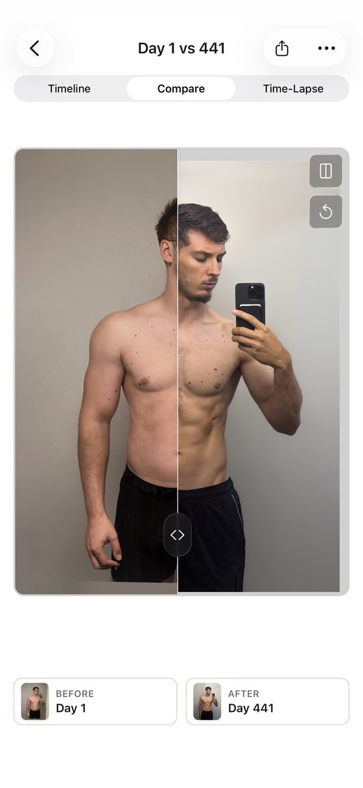
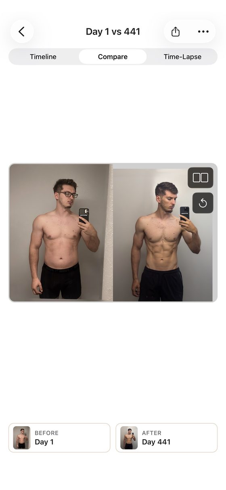
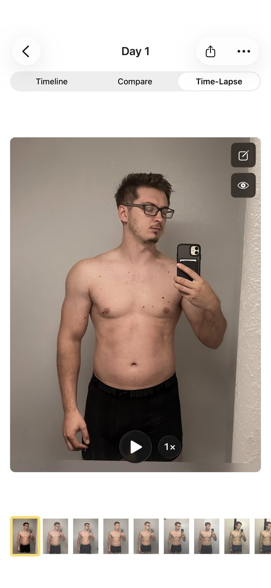
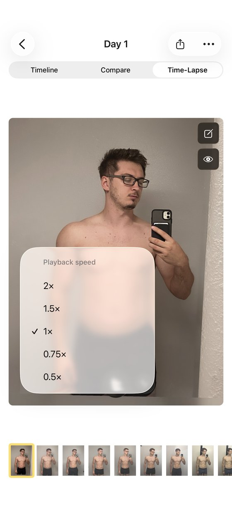
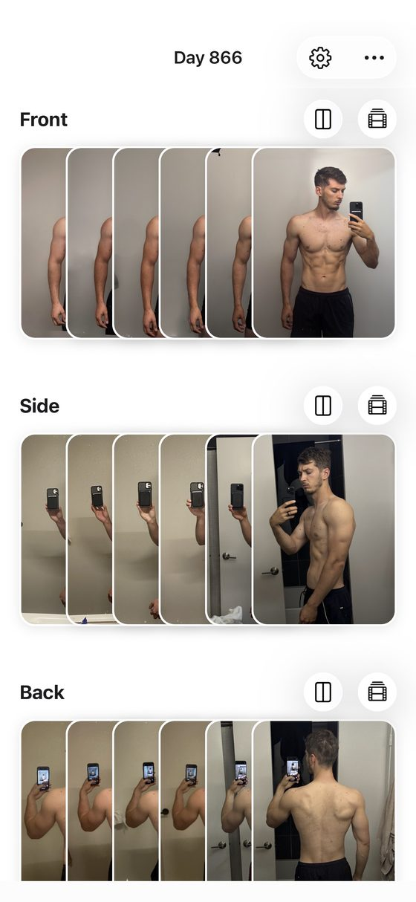
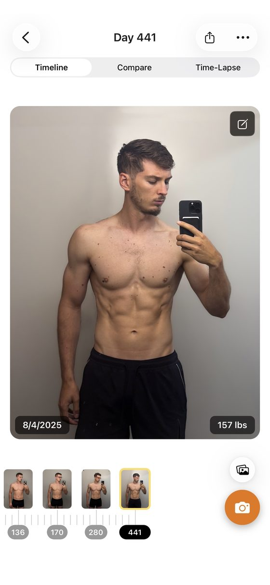

<!-- TODO(Mark): no "sameAs" on the author node yet. /about/ and the site link no X, Instagram, LinkedIn or GitHub profile for Mark. Add it here and on /about/ once one is public. -->

**Full disclosure: I build Recomp, a free progress photo app that competes with this one.** No app pays me <mark class="rounded-sm bg-yellow-200 px-1 text-black box-decoration-clone">\[CONFIRM: no ads, affiliate links or partner deals\]</mark>. Recomp doesn't auto-align photos today, so this is the app I point people to when they want it. This review expands the [Thumbstone entry](/blog/best-progress-photo-apps/#thumbstone) in my [roundup of the best progress photo apps](/blog/best-progress-photo-apps/), scored with [the same kit](/blog/how-i-test-progress-photo-apps/).

<mark class="rounded-sm bg-yellow-200 px-1 text-black box-decoration-clone">\[CONFIRM: Mark's Oct 4 notes call "the app with built-in alignment" the one he liked most; Alfred thinks that's Thumbstone. Confirm before using "favorite" anywhere.\]</mark>

## What it costs {#what-it-costs}

**Progress Pics is a free trial, then a subscription or a lifetime purchase.** The App Store lists Pro Monthly at $4.99, Pro Yearly at $29.99, $14.99 and $9.99, and Pro Lifetime at $39.99. The developer's pricing page lists only $4.99 a month and $29.99 a year, with a 14-day free trial on the yearly plan and "every feature included, no separate tiers." <mark class="rounded-sm bg-yellow-200 px-1 text-black box-decoration-clone">\[CONFIRM: the $9.99 and $14.99 yearly entries are likely offers\]</mark>

## Taking a check-in {#taking-a-check-in}

**I scored capture 4 out of 5: a timer, plus date and weight at capture.** There's no ghost overlay of your last photo. The UI isn't the most intuitive, so my first check-in was also a lesson in where its buttons live. Weight tracking arrived in 1.8.0 on Jul 3, 2026, and a redesigned camera in 1.9.2 on Sep 14. <mark class="rounded-sm bg-yellow-200 px-1 text-black box-decoration-clone">\[TODO: seconds and taps to a saved check-in\]</mark>

## How well auto-align works {#how-well-auto-align-works}

**Auto-align runs after capture and snaps shoulders and hips to guides.** Roughly three in four of my shirtless photos landed right, so I proposed 3 out of 5 for alignment. <mark class="rounded-sm bg-yellow-200 px-1 text-black box-decoration-clone">\[CONFIRM: Mark's "75%" result and the "about three in four" wording\]</mark> Version 1.8.2 on Jul 15, 2026 promised "Smarter AI alignment: pose detection is now more accurate."

**Fixing the misses by hand is the weak spot.** Manual alignment is sluggish, like it has the brakes on. That matters, because one photo in four still needs a correction. I explain why pose-based alignment misses in [how well progress photo auto-alignment works](/blog/progress-photo-auto-alignment/) <mark class="rounded-sm bg-yellow-200 px-1 text-black box-decoration-clone">\[CONFIRM: PR #26 article live before linking\]</mark>. <mark class="rounded-sm bg-yellow-200 px-1 text-black box-decoration-clone">\[TODO: auto-align hit rate on clothed photos\]</mark>

<figure class="m-0 mx-auto w-1/2 max-w-[280px]"><video aria-label="Thumbstone auto-alignment snapping shoulders and hips to the guides" class="block h-auto w-full rounded-card border border-card-border" controls="" height="1214" muted="" playsinline="" poster="../../assets/blog/best-progress-photo-apps/thumbstone-auto-align-poster.webp" preload="none" width="560"><source src="./thumbstone-auto-align.mp4" type="video/mp4"/></video><figcaption class="mt-[0.65rem] text-center text-caption leading-[1.4] text-muted">Auto-align snaps shoulders and hips to the guides.</figcaption></figure>

## Comparing two dates {#comparing-two-dates}

**I scored comparison 4 out of 5, the highest of any app I graded.** It offers side by side, a slider, an overlay with an opacity slider, and a time-lapse with playback controls, and each one can be shared. The UX isn't as smooth as the feature list. Since 1.8.4 on Aug 21, 2026, it shares to Instagram, WhatsApp and Messages and can blur faces on exports.

<mark class="rounded-sm bg-yellow-200 px-1 text-black box-decoration-clone">\[TODO: the roundup says "Thumbstone has every mode \[CONFIRM: stacked\]</mark>". Its own modes are side by side, slider, overlay and time-lapse, with no stacked view confirmed. Confirm before repeating "every mode".\]

<figure class="m-0 min-w-0 flex-1"><figcaption class="mt-[0.65rem] text-center text-caption leading-[1.4] text-muted">Slider compare, Day 1 vs 441.</figcaption></figure><figure class="m-0 min-w-0 flex-1"><figcaption class="mt-[0.65rem] text-center text-caption leading-[1.4] text-muted">Side by side.</figcaption></figure>

<figure class="m-0 min-w-0 flex-1"><figcaption class="mt-[0.65rem] text-center text-caption leading-[1.4] text-muted">Time-lapse from Day 1.</figcaption></figure><figure class="m-0 min-w-0 flex-1"><figcaption class="mt-[0.65rem] text-center text-caption leading-[1.4] text-muted">Playback speed, 0.5× to 2×.</figcaption></figure>

## How it organizes check-ins {#how-it-organizes-check-ins}

**Front, side and back live in three separate stacks.** Each stack has its own timeline that scrubs by day, with the date and weight on each photo. Its site says imports from the camera roll get organized "into your timeline by date," but not whether the date comes from each photo's metadata. <mark class="rounded-sm bg-yellow-200 px-1 text-black box-decoration-clone">\[TODO: whether same-day photos stay linked across the three stacks\]</mark>

<figure class="m-0 min-w-0 flex-1"><figcaption class="mt-[0.65rem] text-center text-caption leading-[1.4] text-muted">Front, side and back stacks.</figcaption></figure><figure class="m-0 min-w-0 flex-1"><figcaption class="mt-[0.65rem] text-center text-caption leading-[1.4] text-muted">Timeline scrubber with date and weight.</figcaption></figure>

## Where your photos live {#where-your-photos-live}

**Photos stay on your device, and there's no account.** The listing says "We do not upload, store, or share your images," and the label reads Data Not Linked to You. Its privacy policy names Google Analytics for Firebase, Firebase Crashlytics, Expo, Sentry, Mixpanel and RevenueCat. The policy also mentions approximate location, which the label doesn't list.

**There's no in-app backup, so deleting the app deletes your photos.** The developer's own FAQ tells you to export your photos and videos before switching phones or removing the app. <mark class="rounded-sm bg-yellow-200 px-1 text-black box-decoration-clone">\[TODO: delete-and-restore test: does an iPhone backup bring its photos back?\]</mark>

## Scores so far {#scores-so-far}

<table class="w-max min-w-full border-collapse text-left text-micro">
<thead>
<tr>
<th class="whitespace-nowrap border-b border-card-border px-3 py-2 align-bottom font-semibold text-fg" scope="col">Score (1 to 5)</th>
<th class="whitespace-nowrap border-b border-card-border px-3 py-2 align-bottom font-semibold text-fg" scope="col">Thumbstone</th>
<th class="whitespace-nowrap border-b border-card-border px-3 py-2 align-bottom font-semibold text-fg" scope="col">Status</th>
</tr>
</thead>
<tbody>
<tr>
<th class="whitespace-nowrap border-b border-card-border px-3 py-2 align-top text-muted" scope="row">Capture and tracking</th>
<td class="border-b border-card-border px-3 py-2 align-top text-muted">4</td>
<td class="border-b border-card-border px-3 py-2 align-top text-muted">Scored</td>
</tr>
<tr>
<th class="whitespace-nowrap border-b border-card-border px-3 py-2 align-top text-muted" scope="row">Alignment</th>
<td class="border-b border-card-border px-3 py-2 align-top text-muted">3</td>
<td class="border-b border-card-border px-3 py-2 align-top text-muted">Proposed</td>
</tr>
<tr>
<th class="whitespace-nowrap border-b border-card-border px-3 py-2 align-top text-muted" scope="row">Comparison</th>
<td class="border-b border-card-border px-3 py-2 align-top text-muted">4</td>
<td class="border-b border-card-border px-3 py-2 align-top text-muted">Scored</td>
</tr>
<tr>
<th class="whitespace-nowrap border-b border-card-border px-3 py-2 align-top text-muted" scope="row">Design</th>
<td class="border-b border-card-border px-3 py-2 align-top text-muted">TBD</td>
<td class="border-b border-card-border px-3 py-2 align-top text-muted"></td>
</tr>
<tr>
<th class="whitespace-nowrap border-b border-card-border px-3 py-2 align-top text-muted" scope="row">Performance</th>
<td class="border-b border-card-border px-3 py-2 align-top text-muted">TBD</td>
<td class="border-b border-card-border px-3 py-2 align-top text-muted">Full-library test pending</td>
</tr>
<tr>
<th class="whitespace-nowrap border-b border-card-border px-3 py-2 align-top text-muted" scope="row">Privacy</th>
<td class="border-b border-card-border px-3 py-2 align-top text-muted">TBD</td>
<td class="border-b border-card-border px-3 py-2 align-top text-muted"></td>
</tr>
<tr>
<th class="whitespace-nowrap border-b border-card-border px-3 py-2 align-top text-muted" scope="row">Backup</th>
<td class="border-b border-card-border px-3 py-2 align-top text-muted">TBD</td>
<td class="border-b border-card-border px-3 py-2 align-top text-muted"></td>
</tr>
<tr>
<th class="whitespace-nowrap border-b border-card-border px-3 py-2 align-top text-muted" scope="row">Import (bonus, outside the total)</th>
<td class="border-b border-card-border px-3 py-2 align-top text-muted">TBD</td>
<td class="border-b border-card-border px-3 py-2 align-top text-muted"></td>
</tr>
<tr>
<th class="whitespace-nowrap border-b border-card-border px-3 py-2 align-top text-muted" scope="row">Total out of 35</th>
<td class="border-b border-card-border px-3 py-2 align-top text-muted">TBD</td>
<td class="border-b border-card-border px-3 py-2 align-top text-muted">11 from the three scored</td>
</tr>
</tbody>
</table>

<mark class="rounded-sm bg-yellow-200 px-1 text-black box-decoration-clone">\[CONFIRM: rescore on the v8 rubric or the Oct 4 measured tiers; v7 provisional grade was A, 20/25. Beginner all-in-one label.\]</mark>

## The numbers {#the-numbers}

**Every app's numbers sit side by side, with test dates, in [my test data](/blog/how-i-test-progress-photo-apps/#store-data).**

<table class="w-max min-w-full border-collapse text-left text-micro">
<thead>
<tr>
<th class="whitespace-nowrap border-b border-card-border px-3 py-2 align-bottom font-semibold text-fg" scope="col">Field</th>
<th class="whitespace-nowrap border-b border-card-border px-3 py-2 align-bottom font-semibold text-fg" scope="col">Value</th>
</tr>
</thead>
<tbody>
<tr>
<th class="whitespace-nowrap border-b border-card-border px-3 py-2 align-top text-muted" scope="row">Full name</th>
<td class="border-b border-card-border px-3 py-2 align-top text-muted">Progress Pics: Body Tracker (Thumbstone Labs Ltd)</td>
</tr>
<tr>
<th class="whitespace-nowrap border-b border-card-border px-3 py-2 align-top text-muted" scope="row">Rating</th>
<td class="border-b border-card-border px-3 py-2 align-top text-muted">4.65 from 43 US ratings (Oct 3, 2026)</td>
</tr>
<tr>
<th class="whitespace-nowrap border-b border-card-border px-3 py-2 align-top text-muted" scope="row">Written reviews, Jul 2 to Oct 2, 2026</th>
<td class="border-b border-card-border px-3 py-2 align-top text-muted">0 (US feed)</td>
</tr>
<tr>
<th class="whitespace-nowrap border-b border-card-border px-3 py-2 align-top text-muted" scope="row">First released</th>
<td class="border-b border-card-border px-3 py-2 align-top text-muted">Mar 8, 2026 <mark class="rounded-sm bg-yellow-200 px-1 text-black box-decoration-clone">[CONFIRM: same date as GainFrame]</mark></td>
</tr>
<tr>
<th class="whitespace-nowrap border-b border-card-border px-3 py-2 align-top text-muted" scope="row">Last updated</th>
<td class="border-b border-card-border px-3 py-2 align-top text-muted">Sep 24, 2026</td>
</tr>
<tr>
<th class="whitespace-nowrap border-b border-card-border px-3 py-2 align-top text-muted" scope="row">Version tested</th>
<td class="border-b border-card-border px-3 py-2 align-top text-muted">1.9.4 <mark class="rounded-sm bg-yellow-200 px-1 text-black box-decoration-clone">[CONFIRM]</mark></td>
</tr>
<tr>
<th class="whitespace-nowrap border-b border-card-border px-3 py-2 align-top text-muted" scope="row">Requires</th>
<td class="border-b border-card-border px-3 py-2 align-top text-muted">iOS 16.4+ on iPhone, plus Apple Silicon Mac and Vision Pro; no iPad</td>
</tr>
<tr>
<th class="whitespace-nowrap border-b border-card-border px-3 py-2 align-top text-muted" scope="row">Android</th>
<td class="border-b border-card-border px-3 py-2 align-top text-muted">Yes, on Google Play (updated Sep 25, 2026)</td>
</tr>
<tr>
<th class="whitespace-nowrap border-b border-card-border px-3 py-2 align-top text-muted" scope="row">App Store search</th>
<td class="border-b border-card-border px-3 py-2 align-top text-muted">No. 1 for "progress photos"</td>
</tr>
<tr>
<th class="whitespace-nowrap border-b border-card-border px-3 py-2 align-top text-muted" scope="row">Names</th>
<td class="border-b border-card-border px-3 py-2 align-top text-muted">The listing has been renamed twice since September; its site says "Body Tracker" and its policy "Body Transformation app"</td>
</tr>
<tr>
<th class="whitespace-nowrap border-b border-card-border px-3 py-2 align-top text-muted" scope="row">App Store</th>
<td class="border-b border-card-border px-3 py-2 align-top text-muted"><a href="https://apps.apple.com/us/app/progress-pics-body-tracker/id6758867697">Progress Pics: Body Tracker on the App Store</a></td>
</tr>
</tbody>
</table>

## Who should use something else {#who-should-use-something-else}

**If you want a one-time price and iCloud sync, use [Fit-Stitch](/blog/fit-stitch-review/).** If you want date-reading import and a voice timer, see [Then &amp; Now](/blog/then-and-now-review/). Thumbstone's short track record is its other risk: 43 ratings since March 2026.

## What I haven't tested yet {#what-i-havent-tested-yet}

**I still need its design and performance scores, a clothed-photo auto-align run, and a restore test.** The full-library test decides whether its stacks stay fast with hundreds of photos. If you've used Thumbstone's auto-align on clothed photos, email me at [support@progressphotos.app](mailto:support@progressphotos.app).

<!-- chrome:author-bio depth="2" -->
<aside
class="mt-12 flex flex-wrap items-center gap-4 rounded-card border border-card-border bg-card px-[1.4rem] py-[1.35rem] sm:flex-nowrap sm:items-start"
aria-labelledby="author-bio-heading"
>
<!-- TODO(Mark): pick a photo. Replace this div with . The 64×64 box is reserved so nothing shifts. -->

<mark class="rounded-sm bg-yellow-200 px-1 text-black box-decoration-clone">TODO photo</mark>

<h2 id="author-bio-heading" class="min-w-0 flex-1 text-h4 font-bold tracking-h4">About the author</h2>

<strong class="text-fg">I'm Mark Stepchin, and I make Recomp, so read what I say about other apps with that in mind.</strong>
I'm a software engineer who has worked at Silicon Valley startups, with some time at Apple.
I've trained for years: I bulked from 145 to 195 lb, cut to 155, and now sit around 165.
Before building Recomp in my evenings and weekends from San Diego, I tried more than 10 progress photo apps.
<a href="../../about/">More about me</a>

<!-- TODO(Mark): the weight history comes from your Oct 17 brief and isn't on /about/ yet. Confirm the numbers before publishing. -->
<!-- TODO(Mark): "tried more than 10" is the public claim from /blog/why-i-built-recomp/. Don't say "tested 36 apps": 36 is the proposed candidate list in the how-i-test draft, with no screening log yet, and hands-on scoring is partial (6 of 10 apps have proposed scores). Once testing is done, this could read "I screened 36 apps and tested N hands-on." -->

</aside>
<!-- /chrome:author-bio -->
