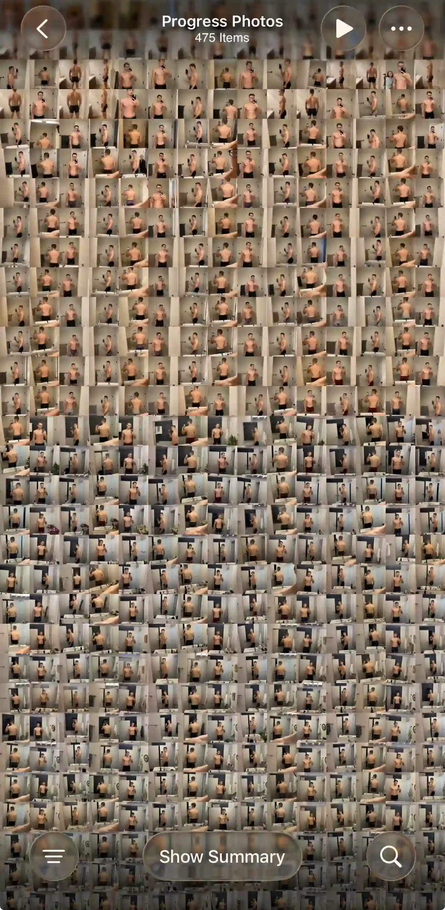

<aside
  class="rounded-card border border-card-border bg-card px-[1.4rem] py-[1.35rem]"
  aria-labelledby="quick-answer-heading"
>
  <h2 id="quick-answer-heading" class="text-h4 font-bold tracking-h4">
    Quick Answer
  </h2>
  

    I built Recomp because after years of progress photos, I couldn't
    find an app that made it fast to take, align, and compare them.
    Recomp focuses on effortless photo and weight check-ins, with a
    side-by-side comparison timeline that lets you instantly switch
    between dates. It's built to sit alongside the apps you already use,
    like Hevy and MyFitnessPal.
  

</aside>

*+*]:mt-[1em] [&_h2]:mt-[2.25em] [&_h2]:text-h3 [&_h2]:leading-h3 [&_h2]:tracking-h3 [&_h2]:font-bold [&_h3]:mt-[1.75em] [&_h3]:text-[1.0625rem] [&_h3]:leading-[1.35] [&_h3]:tracking-h4 [&_h3]:font-bold [&_p]:text-muted [&_li]:text-muted [&_strong]:text-fg [&_strong]:font-semibold [&_ul]:list-disc [&_ul]:pl-5 [&_ol]:list-decimal [&_ol]:pl-5 pt-4">

<figure class="m-0 mx-auto mt-12 w-1/2 max-w-[280px]"><figcaption class="mt-[0.65rem] text-center text-caption leading-[1.4] text-muted">Years of weekly check-ins, still stuck in my camera roll.</figcaption></figure>

## How I Started Taking Progress Photos

After hitting a fat-loss plateau, I hired an online lifting coach. Every week I sent front, side, and back photos, my weight, and a review of my diet and workouts, and he adjusted my plan from there.

I've already been working out consistently for several years, and previously only tracked my workouts. Adding weekly photos and weigh-ins was new to me, and it showed me something I didn't expect.

**I was terrible at seeing progress in my own photos.** Even when my coach pointed out the differences, I struggled to see them. Alignment made a huge difference when comparing.

My coach used one app for tracking workouts, macros, and progress photos. I used it because he used it, not because I loved it. The workout tracking wasn't as good as Hevy or Strong, and the food tracking wasn't as good as MyFitnessPal. But it got me tracking my photos and weight every week, and it showed me the value of tracking my results.

When coaching ended, my photos had nowhere to go. By then I had 450 front, side, and back photos. I had MyFitnessPal and Hevy to keep up my fitness routine, but nothing for tracking before-and-after photos.

What I wanted going forward

1. A Monday morning notification reminding me to take photos and weigh in
2. A way to track my weight
3. A way to track my photos
4. A way to compare and align my photos against last week, last month, and so on

Most importantly, I wanted the entire loop, from opening the notification to seeing a comparison with last week, to take less than a minute, all on my iPhone.

## What I Tried First

I tried a DIY setup with a combination of iOS Photos, Notes for weight tracking, and Calendar reminders for consistency. It was missing the most important part of the loop: the compare view. I tried filling the gap with collage apps or comparing on my laptop, but it was clumsy and broke the instant feedback loop.

Since I already used MyFitnessPal and Hevy, I tried their built-in progress photo tracking. However, I found that it was tucked away from the main experience and hard to get to, and comparing and aligning felt awkward. Remember how hard it was for me to see my own progress? Without precise alignment and instant navigation between photos, I couldn't tell whether I was progressing.

Next, I tried dedicated apps designed specifically for progress photo tracking. I downloaded more than 10 of them and even signed up for subscriptions. I didn't find a single one I enjoyed using or could see myself sticking with long-term, either due to the design, the ads, or the cumbersome navigation. Most importantly, none of them could import the photos I already had. Adding 450 photos one by one would have taken hours and thousands of taps.

**So I decided to build my own app, with four principles:**

1. Tracking must be effortless. If it takes more than a minute and a few taps, consistency drops.
2. The app needs to stay out of the way. Users are here to see their photos, not my fancy buttons.
3. It's a powerful tool for power users, with top-notch performance across hundreds or thousands of photos.
4. It's a specialized tool, designed to fit into the suite of specialized apps power users already rely on.

I quickly realized that building a performant, intuitive photo gallery and editor sounds easy. In practice it comes with a mountain of invisible work that nobody notices until something goes wrong. That also explained why the apps I'd tried felt the way they did. I'm still actively working to make every interaction feel truly seamless and delightful. If you run into an edge case or have any feedback, I'd love to hear from you at [support@progressphotos.app](mailto:support@progressphotos.app).

