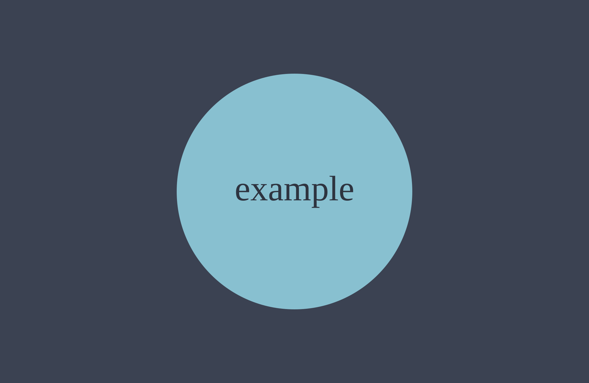

Intro paragraph. Raw HTML is allowed, so `<mark>`, `<figure>` and tables work as they do today.

<!-- TODO: link to future bulk import article -->

<!--
  todo (multiline, any case): stripped from output, and fails the build if draft is false.
-->

## Why this heading keeps its anchor {#existing-anchor-id}

Headings take an explicit id so existing `#` links never change.

### A subsection {#a-subsection}

Visible review markers like <mark class="rounded-sm bg-yellow-200 px-1 text-black box-decoration-clone">[CONFIRM: a fact to check]</mark> only print a warning.

